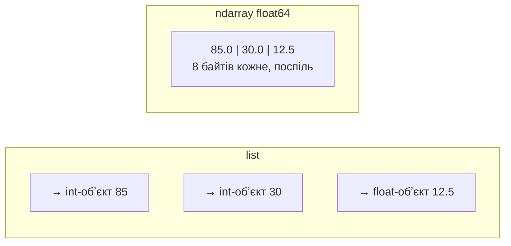
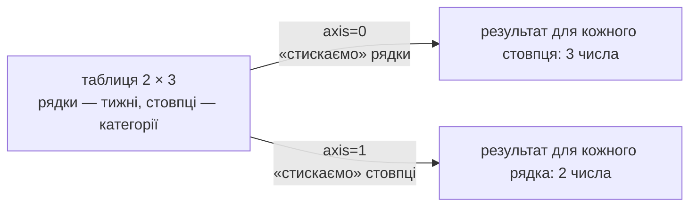

# 25. (Л) Вступ до NumPy. Масиви ndarray, створення, типи даних

## Зміст лекції

1. Навіщо NumPy, якщо є списки
2. Встановлення та імпорт
3. Масив `ndarray`
4. Атрибути масиву: `shape`, `ndim`, `size`, `dtype`
5. Створення масивів
6. Послідовності: `arange` і `linspace`
7. Типи даних `dtype`
8. Перетворення типів: `astype`
9. Форма масиву: `reshape`, `ravel`, транспонування
10. Поелементні операції
11. Агрегатні функції та осі
12. Векторизація замість циклів
13. Читання і запис масивів
14. Приклад: витрати за місяць
15. Типові помилки

## Навіщо NumPy, якщо є списки

Списки Python (лекція 14, 5 семестр) зберігають будь-які обʼєкти: числа, рядки, інші списки. Ця гнучкість дорого коштує для обчислень:

- кожен елемент — окремий обʼєкт Python з власним заголовком у памʼяті;
- операція над елементами — цикл Python, а інтерпретатор повільний;
- `[1, 2, 3] * 2` дає `[1, 2, 3, 1, 2, 3]`, а не подвоєні числа.

**NumPy** (Numerical Python) — бібліотека для роботи з **масивами чисел**. Масив NumPy зберігає числа одного типу щільним блоком памʼяті, а операції над ними виконуються скомпільованим кодом на C — у десятки й сотні разів швидше за цикли Python. На NumPy побудовано pandas, matplotlib, SciPy, scikit-learn, PyTorch.



```python
# Program: the same computation with a list and with NumPy
import time

import numpy as np

values = list(range(1_000_000))
array = np.arange(1_000_000)
array * 2  # «розігрів»: перший виклик повільніший

start = time.perf_counter()
doubled_list = [v * 2 for v in values]
list_time = time.perf_counter() - start

start = time.perf_counter()
doubled_array = array * 2
array_time = time.perf_counter() - start

print("same result:", doubled_list[:5] == doubled_array[:5].tolist())
print("NumPy is faster:", array_time < list_time)
print("[1, 2, 3] * 2 =", [1, 2, 3] * 2, "| np.array([1, 2, 3]) * 2 =", np.array([1, 2, 3]) * 2)
```

```text
same result: True
NumPy is faster: True
[1, 2, 3] * 2 = [1, 2, 3, 1, 2, 3] | np.array([1, 2, 3]) * 2 = [2 4 6]
```

## Встановлення та імпорт

```bash
python3 -m pip install numpy
python3 -c "import numpy as np; print(np.__version__)"
```

```text
2.5.4
```

NumPy за домовленістю імпортують під коротким іменем `np`: так пишуть у документації, підручниках і на Stack Overflow.

## Масив `ndarray`

Основний обʼєкт NumPy — **`ndarray`** (N-dimensional array, N-вимірний масив): таблиця елементів **одного типу** з довільною кількістю вимірів (**осей**).

| Вимірів | Назва | Приклад |
|---|---|---|
| 0 | скаляр | одна сума |
| 1 | вектор | витрати по днях місяця |
| 2 | матриця | витрати: дні × категорії |
| 3 | тензор | місяці × дні × категорії; кольорове зображення: висота × ширина × канал |

```python
# Program: arrays with one, two and three dimensions
import numpy as np

days = np.array([85.5, 30.0, 185.0, 315.0])
table = np.array([[85.5, 30.0, 0.0],
                  [185.0, 12.5, 315.0]])
cube = np.zeros((2, 3, 4))

print(days)
print(table)
print(type(days).__name__, days.ndim, table.ndim, cube.ndim)
```

```text
[ 85.5  30.  185.  315. ]
[[ 85.5  30.    0. ]
 [185.   12.5 315. ]]
ndarray 1 2 3
```

NumPy друкує масиви без коми між елементами — так їх легко відрізнити від списків.

## Атрибути масиву: `shape`, `ndim`, `size`, `dtype`

| Атрибут | Значення |
|---|---|
| `shape` | кортеж розмірів за кожною віссю |
| `ndim` | кількість вимірів |
| `size` | загальна кількість елементів |
| `dtype` | тип елементів |
| `itemsize` | байтів на елемент |
| `nbytes` | байтів на весь масив |

```python
# Program: array attributes
import numpy as np

table = np.array([[85.5, 30.0, 0.0],
                  [185.0, 12.5, 315.0]])
print("shape:", table.shape, "| ndim:", table.ndim, "| size:", table.size)
print("dtype:", table.dtype, "| itemsize:", table.itemsize, "| nbytes:", table.nbytes)
print("rows:", table.shape[0], "| columns:", table.shape[1])
```

```text
shape: (2, 3) | ndim: 2 | size: 6
dtype: float64 | itemsize: 8 | nbytes: 48
rows: 2 | columns: 3
```

`shape` читають так: «2 рядки по 3 стовпці». Вісь 0 — рядки, вісь 1 — стовпці.

## Створення масивів

| Функція | Що створює |
|---|---|
| `np.array(sequence)` | з списку чи вкладених списків |
| `np.zeros(shape)` / `np.ones(shape)` | нулі / одиниці |
| `np.full(shape, value)` | масив, заповнений значенням |
| `np.empty(shape)` | без ініціалізації (швидко, але вміст випадковий) |
| `np.eye(n)` | одинична матриця |
| `np.zeros_like(a)` | нулі тієї самої форми й типу, що `a` |

```python
# Program: ways to create arrays
import numpy as np

print(np.zeros(3))
print(np.ones((2, 3), dtype=int))
print(np.full((2, 2), 3000.0))
print(np.eye(3, dtype=int))
budget = np.array([3000.0, 600.0, 1000.0])
print(np.zeros_like(budget), np.zeros_like(budget).dtype)
```

```text
[0. 0. 0.]
[[1 1 1]
 [1 1 1]]
[[3000. 3000.]
 [3000. 3000.]]
[[1 0 0]
 [0 1 0]
 [0 0 1]]
[0. 0. 0.] float64
```

Форму передають **кортежем**: `np.zeros((2, 3))`, а не `np.zeros(2, 3)` — другий аргумент функції означає тип.

## Послідовності: `arange` і `linspace`

| Функція | Що задають | Приклад |
|---|---|---|
| `np.arange(start, stop, step)` | **крок** (як `range`, але й для дробів) | `np.arange(0, 1, 0.25)` |
| `np.linspace(start, stop, num)` | **кількість точок**, кінець включно | `np.linspace(0, 1, 5)` |

```python
# Program: arange and linspace
import numpy as np

print(np.arange(1, 31, 7))
print(np.arange(0, 1, 0.25))
print(np.linspace(0, 1, 5))
print(len(np.linspace(0, 2 * np.pi, 100)))
```

```text
[ 1  8 15 22 29]
[0.   0.25 0.5  0.75]
[0.   0.25 0.5  0.75 1.  ]
100
```

Для дробового кроку краще `linspace`: через похибки чисел з рухомою комою (лекція 4, 5 семестр) `arange` може дати на один елемент більше чи менше, ніж очікувалося.

## Типи даних `dtype`

| dtype | Значення | Байти |
|---|---|---|
| `int64`, `int32`, `int8` | цілі зі знаком | 8, 4, 1 |
| `uint8` | цілі без знаку 0–255 (пікселі зображень) | 1 |
| `float64`, `float32` | дробові | 8, 4 |
| `bool` | `True` / `False` | 1 |
| `complex128` | комплексні | 16 |
| `<U10` | рядки Unicode до 10 символів | 40 |

NumPy визначає тип автоматично: якщо хоча б одне число дробове — весь масив `float64`.

```python
# Program: dtype is chosen automatically or explicitly
import numpy as np

print(np.array([1, 2, 3]).dtype, np.array([1, 2.5]).dtype, np.array([True, False]).dtype)
print(np.array(["food", "fun"]).dtype)
small = np.array([1, 2, 3], dtype=np.int8)
print(small.dtype, small.nbytes, "bytes")
print("int8 range:", np.iinfo(np.int8).min, "..", np.iinfo(np.int8).max)
```

```text
int64 float64 bool
<U4
int8 3 bytes
int8 range: -128 .. 127
```

!!! warning "Переповнення цілих типів"
    Цілі NumPy мають фіксований розмір, на відміну від `int` у Python. `np.array([127], dtype=np.int8) + 1` дає `-128`: значення «загортається». Для грошей і лічильників використовуйте `int64` або `float64`.

## Перетворення типів: `astype`

`astype` повертає **новий** масив з іншим типом:

```python
# Program: convert between dtypes
import numpy as np

amounts = np.array([85.5, 30.0, 185.99])
print(amounts.astype(int))
print(np.round(amounts).astype(int))
print(np.array(["85.5", "30", "12.25"]).astype(float))
print((amounts > 50).astype(int))
```

```text
[ 85  30 185]
[ 86  30 186]
[85.5  30.   12.25]
[1 0 1]
```

`astype(int)` **відкидає** дробову частину (`185.99` → `185`), а не округлює. Для округлення спочатку `np.round`.

## Форма масиву: `reshape`, `ravel`, транспонування

`reshape` змінює форму без зміни даних: кількість елементів має збігатися. Один розмір можна задати `-1` — NumPy обчислить його сам:

```python
# Program: reshape, ravel and transpose
import numpy as np

week = np.arange(1, 15)  # витрати за 14 днів
by_week = week.reshape(2, 7)
print(by_week)
print("shape:", by_week.shape, "| reshape(-1, 2):", week.reshape(-1, 2).shape)
print("ravel:", by_week.ravel()[:5])
print("transposed shape:", by_week.T.shape)
print(by_week.T[:3])
```

```text
[[ 1  2  3  4  5  6  7]
 [ 8  9 10 11 12 13 14]]
shape: (2, 7) | reshape(-1, 2): (7, 2)
ravel: [1 2 3 4 5]
transposed shape: (7, 2)
[[ 1  8]
 [ 2  9]
 [ 3 10]]
```

`reshape` для масиву з 14 елементів у форму `(3, 5)` спричинить `ValueError: cannot reshape array of size 14 into shape (3,5)`.

## Поелементні операції

Арифметичні оператори й математичні функції NumPy (`np.sqrt`, `np.exp`, `np.log`, `np.abs`) застосовуються **до кожного елемента**:

```python
# Program: element-wise arithmetic and functions
import numpy as np

prices = np.array([85.5, 30.0, 185.0])
quantity = np.array([2, 10, 1])
print("cost:", prices * quantity)
print("with 20% VAT:", prices * 1.2)
print("difference:", prices - prices.mean())
print("sqrt:", np.sqrt(np.array([4, 9, 16])))
print("comparison:", prices > 50)
```

```text
cost: [171. 300. 185.]
with 20% VAT: [102.6  36.  222. ]
difference: [-14.66666667 -70.16666667  84.83333333]
sqrt: [2. 3. 4.]
comparison: [ True False  True]
```

Операції над двома масивами вимагають сумісних форм. Як NumPy поєднує масиви різних форм (**broadcasting**), — у лекції 27.

## Агрегатні функції та осі

| Функція | Результат |
|---|---|
| `sum`, `prod` | сума, добуток |
| `mean`, `median` | середнє, медіана |
| `min`, `max`, `argmin`, `argmax` | найменше, найбільше та їхні індекси |
| `std`, `var` | стандартне відхилення, дисперсія |
| `cumsum` | накопичувальна сума |

Для багатовимірних масивів параметр **`axis`** визначає, вздовж якої осі рахувати:



```python
# Program: aggregate the whole table, columns and rows
import numpy as np

# рядки — тижні, стовпці — food, transport, fun
weeks = np.array([[420.0, 90.0, 315.0],
                  [610.0, 75.0, 0.0]])
print("total:", weeks.sum())
print("per category (axis=0):", weeks.sum(axis=0))
print("per week (axis=1):", weeks.sum(axis=1))
print("biggest category index:", weeks.sum(axis=0).argmax())
print("running total of food:", weeks[:, 0].cumsum())
print(f"mean {weeks.mean():.2f}, std {weeks.std():.2f}")
```

```text
total: 1510.0
per category (axis=0): [1030.  165.  315.]
per week (axis=1): [825. 685.]
biggest category index: 0
running total of food: [ 420. 1030.]
mean 251.67, std 216.58
```

## Векторизація замість циклів

**Векторизація** — запис обчислень операціями над цілими масивами замість циклів Python. Код стає коротшим і швидшим:

```python
# Program: a loop and a vectorized version give the same answer
import numpy as np

amounts = np.array([85.5, 30.0, 185.0, 315.0, 12.5, 640.0])
limit = 100.0

# цикл Python
over = 0.0
for amount in amounts:
    if amount > limit:
        over += amount - limit

# векторизовано
over_vector = np.sum(np.maximum(amounts - limit, 0))
print(over, over_vector, over == over_vector)
```

```text
840.0 840.0 True
```

`np.maximum(a, 0)` поелементно обирає більше з двох значень — так відʼємні різниці перетворюються на нуль без `if`.

## Читання і запис масивів

| Функція | Формат |
|---|---|
| `np.loadtxt(path, delimiter=",")` / `np.savetxt(...)` | текстовий CSV лише з числами |
| `np.genfromtxt(...)` | CSV з пропусками (`nan`) |
| `np.save(path, a)` / `np.load(path)` | бінарний `.npy` — швидко й точно |

```python
# Program: save and load arrays in text and binary formats
import tempfile
from pathlib import Path

import numpy as np

folder = Path(tempfile.mkdtemp())
weeks = np.array([[420.0, 90.0, 315.0], [610.0, 75.0, 0.0]])
np.savetxt(folder / "weeks.csv", weeks, delimiter=",", fmt="%.2f", header="food,transport,fun", comments="")
print((folder / "weeks.csv").read_text().splitlines())
loaded = np.loadtxt(folder / "weeks.csv", delimiter=",", skiprows=1)
print("text round trip:", np.array_equal(loaded, weeks))
np.save(folder / "weeks.npy", weeks)
print("binary round trip:", np.array_equal(np.load(folder / "weeks.npy"), weeks))
```

```text
['food,transport,fun', '420.00,90.00,315.00', '610.00,75.00,0.00']
text round trip: True
binary round trip: True
```

Для таблиць з різними типами стовпців (дата, категорія, сума) NumPy незручний — для них існує pandas (лекція 32).

## Приклад: витрати за місяць

```python
# Program: analyse daily expenses of a month with NumPy
import numpy as np

daily = np.array([85.5, 30, 0, 185, 315, 12.5, 64.5, 0, 0, 120, 45, 30, 210, 0,
                  85, 30, 640, 0, 55, 12.5, 30, 185, 0, 95, 315, 0, 30, 70, 12.5, 150])
print("days:", daily.size, "| total:", daily.sum(), "| average per day:", round(daily.mean(), 2))
print("days without expenses:", np.count_nonzero(daily == 0))
print("most expensive day:", daily.argmax() + 1, "->", daily.max())
weeks = daily[:28].reshape(4, 7)
print("weekly totals:", weeks.sum(axis=1))
print("average by weekday:", np.round(weeks.mean(axis=0), 1))
print("first day when the total passed 2000:", np.argmax(daily.cumsum() > 2000) + 1)
```

```text
days: 30 | total: 2807.5 | average per day: 93.58
days without expenses: 7
most expensive day: 17 -> 640.0
weekly totals: [692.5 405.  852.5 695. ]
average by weekday: [ 88.9  15.  213.8 136.2 100.   66.2  41.1]
first day when the total passed 2000: 22
```

`np.argmax` на масиві `True`/`False` повертає індекс **першого** `True` — зручний спосіб знайти момент, коли умова вперше виконалась.

## Типові помилки

| Помилка | Чому погано | Як правильно |
|---|---|---|
| Цикл `for` по елементах масиву | повільно, втрачається сенс NumPy | векторизовані операції |
| `np.zeros(2, 3)` | `TypeError`: другий аргумент — тип | `np.zeros((2, 3))` |
| Плутають `axis=0` і `axis=1` | сума по рядках замість стовпців | `axis=0` — результат на кожен стовпець |
| `astype(int)` замість округлення | `185.99` → `185` | `np.round(a).astype(int)` |
| Масив з чисел і рядків | усе стає рядками `<U...` | окремі масиви або pandas |
| `int8` для сум | переповнення | `int64`, `float64` |
| `arange` з дробовим кроком | неочікувана кількість елементів | `linspace` |
| `reshape` з неправильною кількістю елементів | `ValueError` | добуток розмірів = `size` або `-1` |

## Підсумок

- **NumPy** працює з масивами чисел одного типу в щільному блоці памʼяті; операції виконуються скомпільованим кодом і в десятки разів швидші за цикли Python.
- **`ndarray`** має форму `shape`, кількість вимірів `ndim`, розмір `size` і тип `dtype`.
- Масиви створюють з `np.array`, `zeros`, `ones`, `full`, `eye`, `arange`, `linspace`.
- `dtype` визначається автоматично або явно; `astype` повертає масив іншого типу.
- `reshape` змінює форму, `.T` транспонує, `ravel` робить масив одновимірним.
- Арифметика й функції NumPy поелементні; агрегатні функції приймають `axis`.
- **Векторизація** замінює цикли операціями над цілими масивами.

## Корисні посилання

- [NumPy — the absolute basics for beginners](https://numpy.org/doc/stable/user/absolute_beginners.html)
- [NumPy quickstart](https://numpy.org/doc/stable/user/quickstart.html)
- [NumPy — Data types](https://numpy.org/doc/stable/user/basics.types.html)
- [NumPy — Array creation](https://numpy.org/doc/stable/user/basics.creation.html)
- VanderPlas J. Python Data Science Handbook. — O'Reilly, 2023. — Розділ 2.
