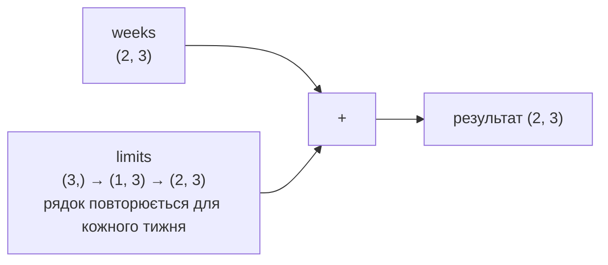

# 27. (Л) Індексація, slicing та broadcasting у NumPy

## Зміст лекції

1. Індекси одновимірного масиву
2. Зрізи (slicing)
3. Індексація двовимірних масивів
4. Рядки, стовпці, діагоналі, підматриці
5. Представлення і копія
6. Логічна (булева) індексація
7. `np.where`, `any`, `all`
8. Індексація списком індексів (fancy indexing)
9. Зміна елементів через індекси й маски
10. Broadcasting: операції над масивами різних форм
11. Правила broadcasting
12. `np.newaxis` і `reshape` для broadcasting
13. Приклади: нормалізація, таблиця множення, відстані
14. Типові помилки

## Індекси одновимірного масиву

Індексація одновимірного масиву така сама, як у списку (лекція 14, 5 семестр): з нуля, відʼємні індекси — з кінця:

```python
# Program: indices of a one-dimensional array
import numpy as np

daily = np.array([85.5, 30.0, 0.0, 185.0, 315.0, 12.5, 64.5])
print("first:", daily[0], "| last:", daily[-1], "| fourth:", daily[3])
print("type of an element:", type(daily[0]).__name__)
```

```text
first: 85.5 | last: 64.5 | fourth: 185.0
type of an element: float64
```

Елемент масиву — скаляр NumPy (`numpy.float64`), а не `float` Python. Він поводиться як звичайне число; перетворити явно можна `float(x)` або `x.item()`.

## Зрізи (slicing)

Зріз `start:stop:step` вибирає частину масиву, `stop` не включається:

```python
# Program: slices of a one-dimensional array
import numpy as np

month = np.arange(1, 31)  # номери днів 1..30
print("first week:", month[:7])
print("last three days:", month[-3:])
print("every 7th day:", month[::7])
print("reversed first week:", month[6::-1])
print("days 10..14:", month[9:14])
```

```text
first week: [1 2 3 4 5 6 7]
last three days: [28 29 30]
every 7th day: [ 1  8 15 22 29]
reversed first week: [7 6 5 4 3 2 1]
days 10..14: [10 11 12 13 14]
```

## Індексація двовимірних масивів

Для двовимірного масиву індекс — пара `[рядок, стовпець]` через кому. Запис `a[1][2]` теж працює, але створює проміжний масив і повільніший:

```python
# Program: indexing a matrix
import numpy as np

# рядки — тижні, стовпці — food, transport, fun, health
weeks = np.array([[420.0, 90.0, 315.0, 0.0],
                  [610.0, 75.0, 0.0, 120.0],
                  [380.0, 60.0, 780.0, 0.0]])
print("week 2, transport:", weeks[1, 1])
print("last week, last category:", weeks[-1, -1])
print("same element, slower:", weeks[1][1])
```

```text
week 2, transport: 75.0
last week, last category: 0.0
same element, slower: 75.0
```

## Рядки, стовпці, діагоналі, підматриці

```python
# Program: rows, columns, sub-matrices and diagonals
import numpy as np

weeks = np.array([[420.0, 90.0, 315.0, 0.0],
                  [610.0, 75.0, 0.0, 120.0],
                  [380.0, 60.0, 780.0, 0.0]])
print("week 1:", weeks[0])
print("food column:", weeks[:, 0])
print("first two weeks, food and transport:\n", weeks[:2, :2])
print("every other column:\n", weeks[:, ::2])

square = np.arange(1, 17).reshape(4, 4)
print("diagonal:", np.diag(square), "| anti-diagonal:", np.diag(np.fliplr(square)))
```

```text
week 1: [420.  90. 315.   0.]
food column: [420. 610. 380.]
first two weeks, food and transport:
 [[420.  90.]
 [610.  75.]]
every other column:
 [[420. 315.]
 [610.   0.]
 [380. 780.]]
diagonal: [ 1  6 11 16] | anti-diagonal: [ 4  7 10 13]
```

| Запис | Що вибирає |
|---|---|
| `a[i]` або `a[i, :]` | рядок `i` |
| `a[:, j]` | стовпець `j` |
| `a[r1:r2, c1:c2]` | підматрицю |
| `a[::2, ::2]` | кожен другий рядок і стовпець |
| `np.diag(a)` | головну діагональ |

## Представлення і копія

Зріз масиву NumPy — це **представлення** (view): новий обʼєкт, що «дивиться» на ті самі дані в памʼяті. Зміна представлення змінює вихідний масив! Так NumPy економить памʼять і час: зріз великого масиву нічого не копіює.

```python
# Program: a slice is a view, copy() makes independent data
import numpy as np

daily = np.array([85.5, 30.0, 0.0, 185.0, 315.0])
first_days = daily[:3]
first_days[0] = 999.0
print("original changed:", daily)
print("shares memory:", np.shares_memory(daily, first_days))

safe = daily[:3].copy()
safe[1] = -1
print("original after copy change:", daily)
print("shares memory:", np.shares_memory(daily, safe))

python_list = [85.5, 30.0, 0.0]
part = python_list[:2]
part[0] = 999.0
print("list slice is a copy:", python_list)
```

```text
original changed: [999.  30.   0. 185. 315.]
shares memory: True
original after copy change: [999.  30.   0. 185. 315.]
shares memory: False
list slice is a copy: [85.5, 30.0, 0.0]
```

| Операція | Результат |
|---|---|
| зріз `a[1:3]`, `a[:, 0]` | представлення |
| `reshape`, `.T`, `ravel` (якщо можливо) | представлення |
| логічна індексація `a[a > 0]` | **копія** |
| індексація списком `a[[0, 2]]` | **копія** |
| `a.copy()` | копія |

Правило: якщо підмасив будуть змінювати, а вихідний масив має лишитися незмінним, — `.copy()`.

## Логічна (булева) індексація

Порівняння масиву дає **масив булевих значень** — **маску**. Маска в квадратних дужках вибирає елементи, де стоїть `True`:

```python
# Program: boolean masks select elements
import numpy as np

daily = np.array([85.5, 30.0, 0.0, 185.0, 315.0, 12.5, 64.5, 0.0, 640.0])
mask = daily > 100
print(mask)
print("big expenses:", daily[mask])
print("how many:", mask.sum(), "| total:", daily[mask].sum())
print("between 10 and 100:", daily[(daily >= 10) & (daily <= 100)])
print("zero or very big:", daily[(daily == 0) | (daily > 500)])
print("not zero:", daily[~(daily == 0)])
```

```text
[False False False  True  True False False False  True]
big expenses: [185. 315. 640.]
how many: 3 | total: 1140.0
between 10 and 100: [85.5 30.  12.5 64.5]
zero or very big: [  0.   0. 640.]
not zero: [ 85.5  30.  185.  315.   12.5  64.5 640. ]
```

| Оператор | Значення |
|---|---|
| `&` | і |
| `\|` | або |
| `~` | не |

!!! warning "Дужки обовʼязкові"
    `daily > 10 & daily < 100` без дужок викличе помилку: `&` має вищий пріоритет, ніж `>` і `<`. Кожну умову беруть у дужки. Слова `and`, `or`, `not` з масивами не працюють: `ValueError: The truth value of an array with more than one element is ambiguous`.

Маску можна застосувати до **іншого** масиву тієї самої довжини — так фільтрують «паралельні» дані:

```python
# Program: one mask for parallel arrays
import numpy as np

days = np.arange(1, 8)
amounts = np.array([85.5, 30.0, 0.0, 185.0, 315.0, 12.5, 64.5])
weekend = (days % 7 == 6) | (days % 7 == 0)
print("weekend days:", days[weekend], "| spent:", amounts[weekend].sum())
print("days with more than 50:", days[amounts > 50])
```

```text
weekend days: [6 7] | spent: 77.0
days with more than 50: [1 4 5 7]
```

## `np.where`, `any`, `all`

| Функція | Що робить |
|---|---|
| `np.where(cond)` | індекси, де умова істинна |
| `np.where(cond, a, b)` | поелементно: `a`, якщо умова істинна, інакше `b` |
| `mask.any()` / `mask.all()` | чи є хоч один `True` / чи всі `True` |
| `np.count_nonzero(mask)` | кількість `True` |

```python
# Program: where, any and all
import numpy as np

amounts = np.array([85.5, 30.0, 0.0, 185.0, 315.0])
print("indices of zero days:", np.where(amounts == 0)[0])
print("labels:", np.where(amounts > 100, "big", "small"))
print("cashback 2% only above 100:", np.where(amounts > 100, amounts * 0.02, 0))
print("any day above 300:", (amounts > 300).any(), "| all days positive:", (amounts > 0).all())
```

```text
indices of zero days: [2]
labels: ['small' 'small' 'small' 'big' 'big']
cashback 2% only above 100: [0.  0.  0.  3.7 6.3]
any day above 300: True | all days positive: False
```

## Індексація списком індексів (fancy indexing)

Масив або список індексів вибирає елементи в потрібному порядку, зокрема з повтореннями:

```python
# Program: select rows and elements by lists of indices
import numpy as np

categories = np.array(["food", "transport", "fun", "health"])
totals = np.array([1410.0, 225.0, 1095.0, 120.0])
order = np.argsort(totals)[::-1]  # індекси від найбільшої суми
print("ranking:", categories[order])
print("top 2:", list(zip(categories[order[:2]], totals[order[:2]])))

weeks = np.arange(12).reshape(3, 4)
print("rows 0 and 2:\n", weeks[[0, 2]])
print("elements (0,1), (2,3):", weeks[[0, 2], [1, 3]])
```

```text
ranking: ['food' 'fun' 'transport' 'health']
top 2: [(np.str_('food'), np.float64(1410.0)), (np.str_('fun'), np.float64(1095.0))]
rows 0 and 2:
 [[ 0  1  2  3]
 [ 8  9 10 11]]
elements (0,1), (2,3): [ 1 11]
```

Зверніть увагу на `np.str_('food')` і `np.float64(1410.0)`: при друці **списку** чи кортежу NumPy 2 показує тип скалярів. Для звичайного вигляду їх перетворюють: `[(str(c), float(t)) ...]` або `.tolist()`.

`np.argsort` повертає індекси, що впорядковують масив, — так сортують кілька «паралельних» масивів однаково.

## Зміна елементів через індекси й маски

Індекси, зрізи й маски можна використовувати **зліва від `=`**:

```python
# Program: assign through slices and masks
import numpy as np

amounts = np.array([85.5, -30.0, 0.0, 185.0, 99999.0, 12.5])
amounts[amounts < 0] = 0           # відʼємні — помилки введення
amounts[amounts > 10000] = np.nan  # явно неправильні значення — «немає даних»
print(amounts)
print("mean without nan:", round(np.nanmean(amounts), 2), "| nan count:", np.isnan(amounts).sum())

table = np.zeros((3, 4))
table[1] = 5          # увесь рядок
table[:, -1] = 1      # останній стовпець
table[0, :2] = [7, 8] # частина рядка
print(table)
```

```text
[ 85.5   0.    0.  185.    nan  12.5]
mean without nan: 56.6 | nan count: 1
[[7. 8. 0. 1.]
 [5. 5. 5. 1.]
 [0. 0. 0. 1.]]
```

`np.nan` (Not a Number) позначає відсутнє значення. Звичайні `sum`, `mean` з `nan` дають `nan`, тому для таких даних є `np.nansum`, `np.nanmean`, `np.nanmax`.

## Broadcasting: операції над масивами різних форм

Що буде, якщо додати до матриці число або вектор? NumPy **«розтягує»** менший масив до форми більшого, не копіюючи даних. Це називається **broadcasting** (поширення):

```python
# Program: broadcasting a scalar, a row and a column
import numpy as np

weeks = np.array([[420.0, 90.0, 315.0],
                  [610.0, 75.0, 0.0]])
limits = np.array([500.0, 100.0, 300.0])   # ліміти категорій, форма (3,)
bonus = np.array([[10.0], [20.0]])          # надбавка тижня, форма (2, 1)

print("plus 1:\n", weeks + 1)
print("minus limits (row for every week):\n", weeks - limits)
print("plus weekly bonus (column for every category):\n", weeks + bonus)
print("over the limit:\n", weeks > limits)
```

```text
plus 1:
 [[421.  91. 316.]
 [611.  76.   1.]]
minus limits (row for every week):
 [[ -80.  -10.   15.]
 [ 110.  -25. -300.]]
plus weekly bonus (column for every category):
 [[430. 100. 325.]
 [630.  95.  20.]]
over the limit:
 [[False False  True]
 [ True False False]]
```



## Правила broadcasting

NumPy порівнює форми **справа наліво**, вимір за виміром. Два виміри **сумісні**, якщо вони рівні або один з них дорівнює `1`. Якщо в одного масиву вимірів менше, зліва дописуються одиниці.

| Форма A | Форма B | Результат |
|---|---|---|
| `(2, 3)` | `()` скаляр | `(2, 3)` |
| `(2, 3)` | `(3,)` | `(2, 3)` |
| `(2, 3)` | `(2, 1)` | `(2, 3)` |
| `(4, 1)` | `(1, 5)` | `(4, 5)` |
| `(2, 3)` | `(2,)` | **помилка**: 3 і 2 несумісні |

```python
# Program: incompatible shapes raise an error
import numpy as np

weeks = np.ones((2, 3))
per_week = np.array([10.0, 20.0])  # форма (2,), а не (2, 1)
try:
    weeks + per_week
except ValueError as error:
    print("error:", error)
print("fixed:", (weeks + per_week.reshape(2, 1)).shape)
```

```text
error: operands could not be broadcast together with shapes (2,3) (2,) 
fixed: (2, 3)
```

## `np.newaxis` і `reshape` для broadcasting

Щоб одновимірний масив поводився як **стовпець**, йому додають вісь: `v[:, np.newaxis]` або `v.reshape(-1, 1)`. Як **рядок** — `v[np.newaxis, :]`:

```python
# Program: turn a vector into a column or a row
import numpy as np

v = np.array([1, 2, 3])
print(v.shape, v[:, np.newaxis].shape, v[np.newaxis, :].shape, v.reshape(-1, 1).shape)
```

```text
(3,) (3, 1) (1, 3) (3, 1)
```

## Приклади: нормалізація, таблиця множення, відстані

**Частка кожної категорії у тижні** — ділимо рядки на їхні суми:

```python
# Program: share of each category inside every week
import numpy as np

weeks = np.array([[420.0, 90.0, 315.0, 0.0],
                  [610.0, 75.0, 0.0, 120.0]])
week_totals = weeks.sum(axis=1, keepdims=True)  # форма (2, 1), а не (2,)
shares = weeks / week_totals
print(np.round(shares * 100, 1))
print("every row sums to 100%:", np.allclose(shares.sum(axis=1), 1))
```

```text
[[50.9 10.9 38.2  0. ]
 [75.8  9.3  0.  14.9]]
every row sums to 100%: True
```

`keepdims=True` зберігає вісь, по якій рахували: форма `(2, 1)` одразу придатна для broadcasting.

**Мін-макс нормалізація стовпців** у діапазон `[0, 1]` — поширена підготовка даних:

```python
# Program: min-max normalisation of columns
import numpy as np

# стовпці: сума, кількість покупок, днів до зарплати
data = np.array([[85.5, 1, 20], [640.0, 3, 5], [12.5, 1, 28], [315.0, 2, 12]])
low, high = data.min(axis=0), data.max(axis=0)
normalised = (data - low) / (high - low)
print(np.round(normalised, 2))
```

```text
[[0.12 0.   0.65]
 [1.   1.   0.  ]
 [0.   0.   1.  ]
 [0.48 0.5  0.3 ]]
```

**Таблиця множення** — зовнішній добуток стовпця й рядка:

```python
# Program: a multiplication table by broadcasting
import numpy as np

n = np.arange(1, 6)
print(n[:, np.newaxis] * n[np.newaxis, :])
```

```text
[[ 1  2  3  4  5]
 [ 2  4  6  8 10]
 [ 3  6  9 12 15]
 [ 4  8 12 16 20]
 [ 5 10 15 20 25]]
```

**Відстані між усіма парами точок** без жодного циклу:

```python
# Program: pairwise distances between shops with broadcasting
import numpy as np

shops = np.array([[0.0, 0.0], [3.0, 4.0], [6.0, 8.0]])  # координати в км
diff = shops[:, np.newaxis, :] - shops[np.newaxis, :, :]  # форма (3, 3, 2)
distances = np.sqrt((diff ** 2).sum(axis=2))
print(distances)
```

```text
[[ 0.  5. 10.]
 [ 5.  0.  5.]
 [10.  5.  0.]]
```

## Типові помилки

| Помилка | Чому погано | Як правильно |
|---|---|---|
| Змінюють зріз, вважаючи його копією | несподівано змінився вихідний масив | `.copy()` |
| `a[1][2]` для матриці | повільніше, з присвоєнням може не спрацювати для fancy indexing | `a[1, 2]` |
| `and`, `or` з масивами | `ValueError: truth value ... is ambiguous` | `&`, `\|`, `~` і дужки |
| Умови без дужок `a > 1 & a < 5` | неправильний пріоритет | `(a > 1) & (a < 5)` |
| Сума рядків форми `(n,)` для ділення матриці | `operands could not be broadcast` | `keepdims=True` або `reshape(-1, 1)` |
| Цикли для порівняння з лімітами | повільно й довго | broadcasting |
| `mean` з `nan` | результат `nan` | `np.nanmean` |
| Друкують список скалярів NumPy | `np.float64(...)` у виводі | `.tolist()` або `float()` |

## Підсумок

- Індексація: `a[i]`, `a[-1]`; для матриць — `a[рядок, стовпець]`; зрізи `start:stop:step` по кожній осі.
- Зріз — **представлення** тих самих даних; для незалежних даних — `.copy()`.
- **Логічна індексація** вибирає елементи за маскою; умови поєднують `&`, `|`, `~` з дужками; `np.where` обирає значення за умовою.
- Індексація списком (`a[[0, 2]]`) і `argsort` вибирають і впорядковують елементи; результат — копія.
- Індекси й маски працюють і для присвоєння: `a[a < 0] = 0`.
- **Broadcasting** поширює менший масив до форми більшого: виміри порівнюються справа, сумісні, якщо рівні або один з них `1`; `keepdims` і `np.newaxis` допомагають отримати потрібну форму.

## Корисні посилання

- [NumPy — Indexing on ndarrays](https://numpy.org/doc/stable/user/basics.indexing.html)
- [NumPy — Broadcasting](https://numpy.org/doc/stable/user/basics.broadcasting.html)
- [NumPy — Copies and views](https://numpy.org/doc/stable/user/basics.copies.html)
- [NumPy — `numpy.where`](https://numpy.org/doc/stable/reference/generated/numpy.where.html)
- VanderPlas J. Python Data Science Handbook. — O'Reilly, 2023. — Розділ 2.
