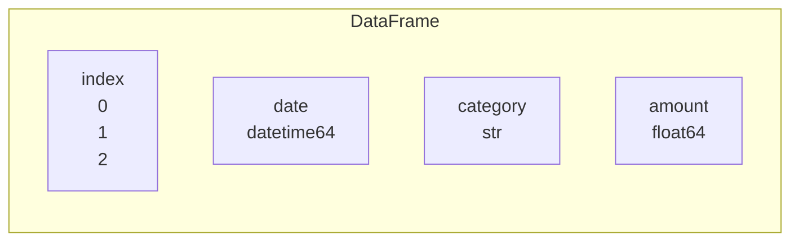

# 32. (Л) Вступ до pandas. Series, DataFrame, читання CSV

## Зміст лекції

1. Чому не вистачає NumPy
2. Встановлення та імпорт
3. `Series`: стовпець з індексом
4. `DataFrame`: таблиця
5. Читання CSV: `read_csv`
6. Перше знайомство з даними
7. Вибір стовпців
8. Вибір рядків: `loc` та `iloc`
9. Фільтрація
10. Нові стовпці
11. Сортування й підрахунок значень
12. Рядки й дати: `.str` і `.dt`
13. Пропущені значення
14. Групування й агрегати
15. Зведені таблиці та обʼєднання таблиць
16. Збереження результату
17. Типові помилки

## Чому не вистачає NumPy

Масив NumPy (лекції 25–30) зберігає дані **одного типу** і звертається до них за номерами. Реальні таблиці інші:

| date | category | amount | comment |
|---|---|---|---|
| 2026-09-21 | food | 85.50 | lunch |
| 2026-09-22 | transport | 30.00 | |

- стовпці різних типів: дата, текст, число;
- до стовпців звертаються **за назвою**, а не за номером;
- бувають пропуски;
- потрібні групування, обʼєднання таблиць, читання й запис CSV, Excel, SQL.

**pandas** — бібліотека для роботи з табличними даними, побудована на NumPy. Її назва походить від *panel data* — термін економетрики. pandas — основний інструмент аналізу даних у Python.

## Встановлення та імпорт

```bash
python3 -m pip install pandas
python3 -c "import pandas as pd; print(pd.__version__)"
```

```text
3.0.6
```

pandas імпортують під іменем `pd`. Приклади лекції виконано в pandas 3; у pandas 2 частина виводу відрізняється, наприклад текстові стовпці там мають тип `object`, а не `str`.

## `Series`: стовпець з індексом

**`Series`** — одновимірний масив значень з **індексом** — підписами елементів:

```python
# Program: a Series has values and an index
import pandas as pd

totals = pd.Series([1410.0, 225.0, 1095.0], index=["food", "transport", "fun"], name="september")
print(totals)
print("food:", totals["food"], "| first:", totals.iloc[0])
print("index:", list(totals.index), "| dtype:", totals.dtype)
print("over 1000:", list(totals[totals > 1000].index))
```

```text
food         1410.0
transport     225.0
fun          1095.0
Name: september, dtype: float64
food: 1410.0 | first: 1410.0
index: ['food', 'transport', 'fun'] | dtype: float64
over 1000: ['food', 'fun']
```

Операції над двома `Series` **вирівнюються за індексом**, а не за позицією:

```python
# Program: arithmetic aligns Series by index labels
import pandas as pd

september = pd.Series({"food": 1410.0, "transport": 225.0, "fun": 1095.0})
october = pd.Series({"fun": 780.0, "food": 1630.0, "health": 120.0})
print(october - september)
print((october - september).fillna(0).sum())
```

```text
food         220.0
fun         -315.0
health         NaN
transport      NaN
dtype: float64
-95.0
```

Категорії, яких немає в одній з таблиць, дають `NaN` — «немає даних». Це захищає від тихих помилок, коли рядки стоять у різному порядку.

## `DataFrame`: таблиця

**`DataFrame`** — таблиця: набір стовпців-`Series` зі спільним індексом рядків.



```python
# Program: create a DataFrame from a dict of columns
import pandas as pd

df = pd.DataFrame({
    "date": pd.to_datetime(["2026-09-21", "2026-09-22", "2026-09-25"]),
    "category": ["food", "transport", "fun"],
    "amount": [85.5, 30.0, 315.0],
})
print(df)
print("shape:", df.shape, "| columns:", list(df.columns))
print(df.dtypes)
```

```text
        date   category  amount
0 2026-09-21       food    85.5
1 2026-09-22  transport    30.0
2 2026-09-25        fun   315.0
shape: (3, 3) | columns: ['date', 'category', 'amount']
date        datetime64[us]
category               str
amount             float64
dtype: object
```

Кожен стовпець має власний тип. Індекс рядків за замовчуванням — `0, 1, 2, ...`.

## Читання CSV: `read_csv`

`pd.read_csv` читає CSV (лекція 21, 5 семестр) одним викликом. Приклади лекції читають дані з рядка через `io.StringIO`, щоб працювати без окремого файлу; з файлом — `pd.read_csv("expenses.csv")`:

```python
# File: data.py
import io

import pandas as pd

CSV = """date,category,amount,comment
2026-09-01,food,85.50,lunch
2026-09-03,transport,30.00,bus
2026-09-05,food,1250.00,groceries
2026-09-12,fun,315.00,cinema
2026-09-14,transport,12.50,tram
2026-09-18,health,,pharmacy
2026-09-20,food,1940.00,groceries
2026-10-02,fun,780.00,concert
2026-10-04,food,64.50,coffee
2026-10-07,transport,30.00,
2026-10-11,food,1630.00,groceries
2026-10-15,health,120.00,dentist
"""


def load() -> pd.DataFrame:
    return pd.read_csv(io.StringIO(CSV), parse_dates=["date"])
```

| Параметр `read_csv` | Значення |
|---|---|
| `sep=";"` | роздільник (типово кома) |
| `parse_dates=["date"]` | перетворити стовпці на дати |
| `dtype={"category": "category"}` | задати типи стовпців |
| `usecols=[...]` | читати лише вказані стовпці |
| `na_values=["-", "n/a"]` | які значення вважати пропуском |
| `encoding="utf-8"` | кодування файлу |
| `nrows=1000` | прочитати лише перші рядки (для великих файлів) |

## Перше знайомство з даними

```python
# Program: look at a new dataset
from data import load

df = load()
print(df.head(3))
print("shape:", df.shape)
df.info()
print(df.describe().round(2))
```

```text
        date   category  amount    comment
0 2026-09-01       food    85.5      lunch
1 2026-09-03  transport    30.0        bus
2 2026-09-05       food  1250.0  groceries
shape: (12, 4)
<class 'pandas.DataFrame'>
RangeIndex: 12 entries, 0 to 11
Data columns (total 4 columns):
 #   Column    Non-Null Count  Dtype         
---  ------    --------------  -----         
 0   date      12 non-null     datetime64[us]
 1   category  12 non-null     str           
 2   amount    11 non-null     float64       
 3   comment   11 non-null     str           
dtypes: datetime64[us](1), float64(1), str(2)
memory usage: 516.0 bytes
                      date   amount
count                   12    11.00
mean   2026-09-21 20:00:00   568.86
min    2026-09-01 00:00:00    12.50
25%    2026-09-10 06:00:00    47.25
50%    2026-09-19 00:00:00   120.00
75%    2026-10-04 18:00:00  1015.00
max    2026-10-15 00:00:00  1940.00
std                    NaN   718.25
```

| Метод | Що показує |
|---|---|
| `head(n)`, `tail(n)` | перші / останні рядки |
| `shape` | (рядки, стовпці) |
| `info()` | типи стовпців і кількість непорожніх значень |
| `describe()` | статистики числових стовпців: кількість, середнє, квартилі, `std` (з `ddof=1`, лекція 30) |
| `columns`, `dtypes` | назви й типи стовпців |

`info()` одразу показує пропуски: в `amount` і `comment` по 11 значень з 12.

## Вибір стовпців

```python
# Program: select one or several columns
from data import load

df = load()
amount = df["amount"]
print(type(amount).__name__, "| total:", amount.sum())
print(df[["date", "amount"]].head(2))
print("unique categories:", sorted(df["category"].unique()))
```

```text
Series | total: 6257.5
        date  amount
0 2026-09-01    85.5
1 2026-09-03    30.0
unique categories: ['food', 'fun', 'health', 'transport']
```

| Запис | Результат |
|---|---|
| `df["amount"]` | один стовпець — `Series` |
| `df[["date", "amount"]]` | кілька стовпців — `DataFrame` (зверніть увагу на подвійні дужки) |

`sum()` пропускає `NaN` автоматично — на відміну від NumPy.

## Вибір рядків: `loc` та `iloc`

| Індексатор | Вибирає за | Приклад |
|---|---|---|
| `df.loc[rows, cols]` | **мітками** індексу й назвами стовпців | `df.loc[2, "amount"]`, `df.loc[0:2, ["date", "amount"]]` |
| `df.iloc[rows, cols]` | **позиціями** (як у NumPy) | `df.iloc[0]`, `df.iloc[-3:, :2]` |

```python
# Program: loc uses labels, iloc uses positions
from data import load

df = load()
print(df.loc[2, "amount"], "|", df.iloc[2, 2])
print(df.loc[0:2, ["category", "amount"]])
print(df.iloc[-2:, :2])
by_date = df.set_index("date")
print(by_date.loc["2026-10-02", "comment"])
```

```text
1250.0 | 1250.0
    category  amount
0       food    85.5
1  transport    30.0
2       food  1250.0
         date category
10 2026-10-11     food
11 2026-10-15   health
concert
```

!!! warning "Зріз у `loc` включає кінець"
    `df.loc[0:2]` повертає рядки з мітками 0, 1 **і 2**, бо це мітки, а не позиції. `df.iloc[0:2]` — лише позиції 0 і 1, як у Python.

## Фільтрація

Логічна індексація (лекція 27) працює й з таблицями: умова над стовпцем дає маску рядків:

```python
# Program: filter rows by conditions
from data import load

df = load()
big = df[df["amount"] > 1000]
print(big[["date", "category", "amount"]])
food_october = df[(df["category"] == "food") & (df["date"].dt.month == 10)]
print("food in october:", food_october["amount"].sum())
print("transport or health:", len(df[df["category"].isin(["transport", "health"])]))
print("between 50 and 500:", df[df["amount"].between(50, 500)]["comment"].tolist())
print(df.query("category == 'fun' and amount > 500"))
```

```text
         date category  amount
2  2026-09-05     food  1250.0
6  2026-09-20     food  1940.0
10 2026-10-11     food  1630.0
food in october: 1694.5
transport or health: 5
between 50 and 500: ['lunch', 'cinema', 'coffee', 'dentist']
        date category  amount  comment
7 2026-10-02      fun   780.0  concert
```

Як і в NumPy, умови поєднують `&`, `|`, `~` і беруть у дужки. Метод `query` приймає умову рядком — зручно для довгих фільтрів.

## Нові стовпці

Новий стовпець отримують, присвоївши результат векторизованої операції:

```python
# Program: add computed columns
import numpy as np

from data import load

df = load()
df["amount_usd"] = (df["amount"] / 41.25).round(2)
df["size"] = np.where(df["amount"] >= 1000, "big", "small")
df["weekday"] = df["date"].dt.day_name()
df["share"] = (df["amount"] / df["amount"].sum() * 100).round(1)
print(df[["date", "amount", "amount_usd", "size", "weekday", "share"]].head(4))
labelled = df.assign(month=df["date"].dt.strftime("%Y-%m"))
print(labelled["month"].unique().tolist())
```

```text
        date  amount  amount_usd   size   weekday  share
0 2026-09-01    85.5        2.07  small   Tuesday    1.4
1 2026-09-03    30.0        0.73  small  Thursday    0.5
2 2026-09-05  1250.0       30.30    big  Saturday   20.0
3 2026-09-12   315.0        7.64  small  Saturday    5.0
['2026-09', '2026-10']
```

`assign` повертає **нову** таблицю з доданим стовпцем, не змінюючи вихідну — зручно в ланцюжках перетворень.

## Сортування й підрахунок значень

```python
# Program: sort rows and count values
from data import load

df = load()
print(df.sort_values("amount", ascending=False).head(3)[["date", "category", "amount"]])
print(df.sort_values(["category", "date"])[["category", "date"]].head(4))
print(df["category"].value_counts())
print(df.nlargest(2, "amount")["comment"].tolist())
```

```text
         date category  amount
6  2026-09-20     food  1940.0
10 2026-10-11     food  1630.0
2  2026-09-05     food  1250.0
  category       date
0     food 2026-09-01
2     food 2026-09-05
6     food 2026-09-20
8     food 2026-10-04
category
food         5
transport    3
fun          2
health       2
Name: count, dtype: int64
['groceries', 'groceries']
```

Порожні значення (`NaN`) під час сортування стоять наприкінці.

## Рядки й дати: `.str` і `.dt`

Для текстових стовпців є методи рядків через `.str`, для дат — властивості через `.dt` (лекція 29, 5 семестр):

```python
# Program: string and datetime accessors
from data import load

df = load()
print(df["comment"].str.upper().head(3).tolist())
print("comments with 'gro':", df["comment"].str.contains("gro", na=False).sum())
print(df["date"].dt.month.unique().tolist(), df["date"].dt.day_name().iloc[0])
print("days between first and last:", (df["date"].max() - df["date"].min()).days)
```

```text
['LUNCH', 'BUS', 'GROCERIES']
comments with 'gro': 3
[9, 10] Tuesday
days between first and last: 44
```

## Пропущені значення

```python
# Program: find and handle missing values
from data import load

df = load()
print(df.isna().sum())
print(df[df["amount"].isna()])
print("drop rows without amount:", len(df.dropna(subset=["amount"])))
filled = df.fillna({"amount": df["amount"].median(), "comment": "no comment"})
print(filled.loc[[5, 9], ["category", "amount", "comment"]])
```

```text
date        0
category    0
amount      1
comment     1
dtype: int64
        date category  amount   comment
5 2026-09-18   health     NaN  pharmacy
drop rows without amount: 11
    category  amount     comment
5     health   120.0    pharmacy
9  transport    30.0  no comment
```

Що робити з пропусками, залежить від задачі:

| Спосіб | Коли |
|---|---|
| `dropna()` | рядків з пропусками мало, і без значення рядок непотрібний |
| `fillna(value)` | є розумне значення за замовчуванням: 0, медіана, «no comment» |
| `ffill()` / `bfill()` | часові ряди: повторити попереднє / наступне значення |
| залишити `NaN` | агрегати pandas самі пропускають `NaN` |

## Групування й агрегати

**Групування** — найпотужніша операція pandas: «розбити рядки на групи → порахувати кожну групу → обʼєднати результат» (split-apply-combine). Це те саме, що `GROUP BY` у SQL (лекція 5, 6 семестр):

```python
# Program: group by category and aggregate
from data import load

df = load()
print(df.groupby("category")["amount"].sum())
summary = df.groupby("category").agg(
    count=("amount", "count"), total=("amount", "sum"), average=("amount", "mean"), biggest=("amount", "max"))
print(summary.round(2).sort_values("total", ascending=False))
monthly = df.groupby(df["date"].dt.to_period("M"))["amount"].sum()
print(monthly)
```

```text
category
food         4970.0
fun          1095.0
health        120.0
transport      72.5
Name: amount, dtype: float64
           count   total  average  biggest
category                                  
food           5  4970.0   994.00   1940.0
fun            2  1095.0   547.50    780.0
health         1   120.0   120.00    120.0
transport      3    72.5    24.17     30.0
date
2026-09    3633.0
2026-10    2624.5
Freq: M, Name: amount, dtype: float64
```

`count` рахує лише непорожні значення: у категорії `health` два рядки, але одна сума.

## Зведені таблиці та обʼєднання таблиць

**Зведена таблиця** (`pivot_table`) — групування за двома ознаками одразу: рядки — одна ознака, стовпці — інша:

```python
# Program: a pivot table and a merge with category limits
import pandas as pd

from data import load

df = load()
df["month"] = df["date"].dt.strftime("%Y-%m")
pivot = df.pivot_table(index="category", columns="month", values="amount", aggfunc="sum", fill_value=0)
print(pivot)

limits = pd.DataFrame({"category": ["food", "fun", "transport"], "limit": [3000.0, 1000.0, 600.0]})
september = df[df["month"] == "2026-09"].groupby("category", as_index=False)["amount"].sum()
report = september.merge(limits, on="category", how="left")
report["over"] = report["amount"] > report["limit"]
print(report)
```

```text
month      2026-09  2026-10
category                   
food        3275.5   1694.5
fun          315.0    780.0
health         0.0    120.0
transport     42.5     30.0
    category  amount   limit   over
0       food  3275.5  3000.0   True
1        fun   315.0  1000.0  False
2     health     0.0     NaN  False
3  transport    42.5   600.0  False
```

`merge` (обʼєднання таблиць за спільним стовпцем) — аналог `JOIN` у SQL: `how="left"` зберігає всі рядки лівої таблиці, як `LEFT JOIN`. Для `health` ліміту немає — `NaN`. Детально групування, зведені таблиці, обʼєднання й часові ряди відпрацьовуються в практичних роботах П16–П17.

## Збереження результату

| Метод | Формат |
|---|---|
| `df.to_csv(path, index=False)` | CSV без стовпця індексу |
| `df.to_json(path, orient="records")` | JSON — список обʼєктів |
| `df.to_excel(path)` | Excel (потрібен пакет `openpyxl`) |
| `df.to_sql(name, connection)` | таблиця бази даних |

```python
# Program: save a report to CSV and JSON
import tempfile
from pathlib import Path

from data import load

folder = Path(tempfile.mkdtemp())
df = load()
summary = df.groupby("category", as_index=False)["amount"].sum().round(2)
summary.to_csv(folder / "summary.csv", index=False)
summary.to_json(folder / "summary.json", orient="records")
print((folder / "summary.csv").read_text().splitlines())
print((folder / "summary.json").read_text())
```

```text
['category,amount', 'food,4970.0', 'fun,1095.0', 'health,120.0', 'transport,72.5']
[{"category":"food","amount":4970.0},{"category":"fun","amount":1095.0},{"category":"health","amount":120.0},{"category":"transport","amount":72.5}]
```

Без `index=False` у CSV зʼявиться зайвий перший стовпець з номерами рядків.

## Типові помилки

| Помилка | Чому погано | Як правильно |
|---|---|---|
| Цикл `for` по рядках (`iterrows`) для обчислень | дуже повільно | векторизовані операції, `groupby` |
| `df["a", "b"]` для кількох стовпців | `KeyError` | `df[["a", "b"]]` |
| `df[df.amount > 10 & df.amount < 100]` | неправильний пріоритет | дужки навколо кожної умови |
| Плутають `loc` і `iloc` | вибрано не ті рядки | `loc` — мітки, `iloc` — позиції |
| Дати як текст | не працюють `.dt`, сортування за місяцем | `parse_dates` або `pd.to_datetime` |
| `df[df.x > 0]["y"] = 1` | у pandas 3 нічого не змінює (Copy-on-Write), у pandas 2 — попередження | `df.loc[df.x > 0, "y"] = 1` |
| `to_csv` без `index=False` | зайвий стовпець у файлі | `index=False` |
| Пропуски не перевірено | несподівані `NaN` у результатах | `info()`, `isna().sum()` |

## Підсумок

- **pandas** працює з таблицями різнотипних даних; основні обʼєкти — `Series` (стовпець з індексом) і `DataFrame` (таблиця).
- Операції над `Series` вирівнюються за індексом; відсутні мітки дають `NaN`.
- `pd.read_csv` читає CSV з параметрами `sep`, `parse_dates`, `dtype`, `na_values`; знайомство з даними — `head`, `info`, `describe`.
- Стовпці вибирають `df["col"]` / `df[["a", "b"]]`, рядки — `loc` (мітки) та `iloc` (позиції), фільтрують масками й `query`.
- Нові стовпці — векторизованими виразами або `assign`; `.str` і `.dt` працюють з текстом і датами.
- Пропуски знаходять `isna`, обробляють `dropna`, `fillna`.
- `groupby` + `agg`, `pivot_table`, `merge` — аналоги `GROUP BY` і `JOIN`; результати зберігають `to_csv`, `to_json`.

## Корисні посилання

- [pandas — 10 minutes to pandas](https://pandas.pydata.org/docs/user_guide/10min.html)
- [pandas — Getting started tutorials](https://pandas.pydata.org/docs/getting_started/intro_tutorials/index.html)
- [pandas — Group by: split-apply-combine](https://pandas.pydata.org/docs/user_guide/groupby.html)
- [pandas — Copy-on-Write](https://pandas.pydata.org/docs/user_guide/copy_on_write.html)
- McKinney W. Python for Data Analysis. — O'Reilly, 2022.
