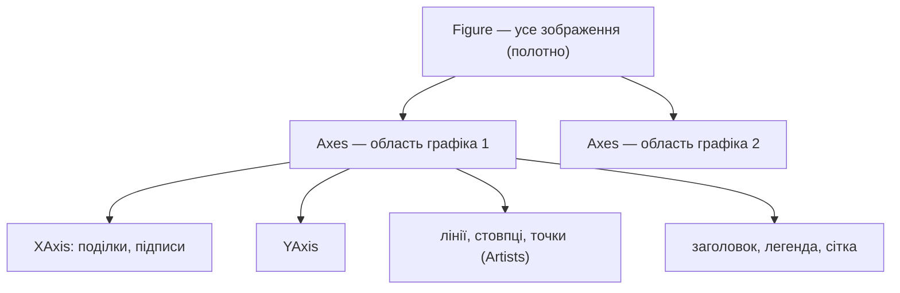
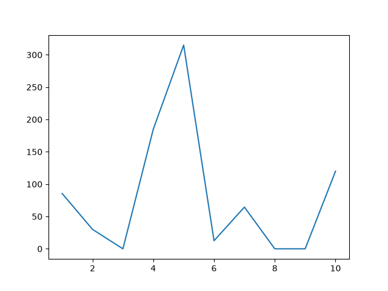
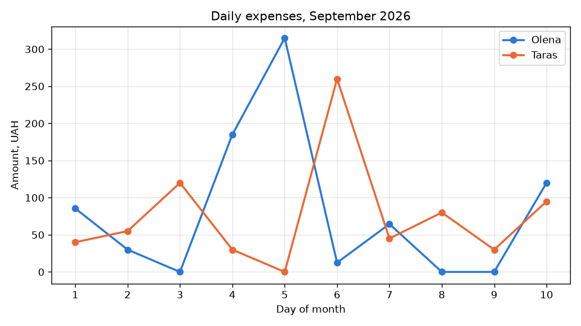
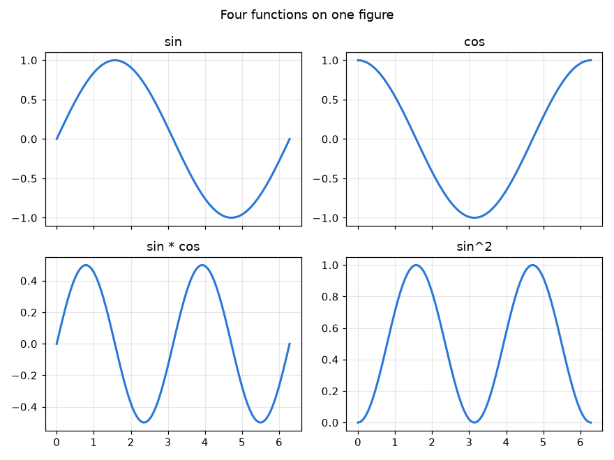
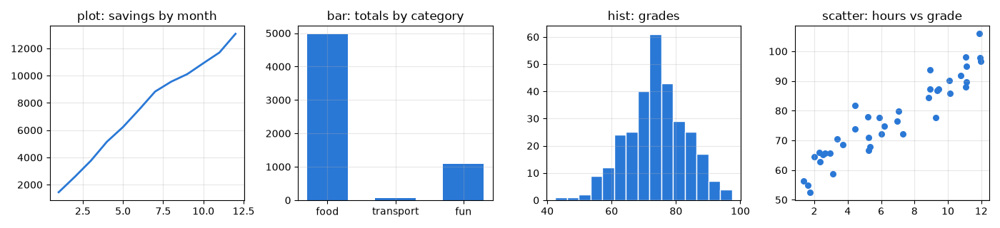
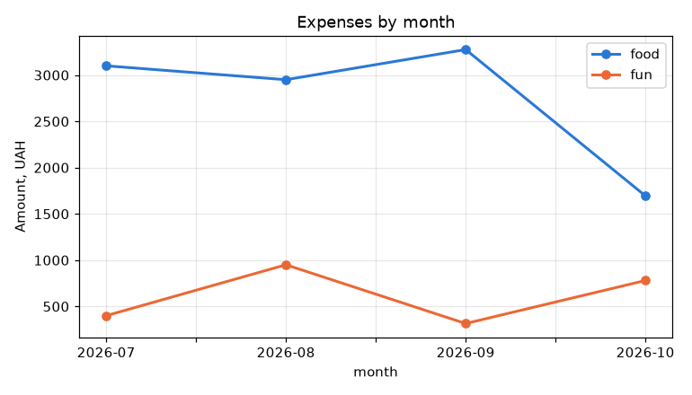

# 35. (Л) Вступ до matplotlib. Структура графіків, figure, axes

## Зміст лекції

1. Навіщо візуалізувати дані
2. Встановлення та імпорт
3. Анатомія графіка: `Figure`, `Axes`, `Axis`
4. Два стилі: pyplot і обʼєктно-орієнтований
5. Перший графік
6. Заголовок, підписи осей, легенда
7. Збереження у файл: `savefig`
8. Кілька графіків на одній фігурі: `subplots`
9. Розмір фігури й роздільна здатність
10. Основні типи графіків
11. Графік з даних pandas
12. Показ у вікні та бекенди
13. Типові помилки

## Навіщо візуалізувати дані

Таблиця з 30 денних витрат (лекція 25) — це числа, а графік одразу показує, у які дні були великі покупки і чи ростуть витрати. Людина помічає закономірності на малюнку значно швидше, ніж у стовпці чисел.

Відомий приклад — **квартет Енскомба**: чотири набори точок з **однаковими** середніми, дисперсіями й кореляцією, які на графіках виглядають зовсім по-різному:

```python
# Program: Anscombe's quartet - same statistics, different data
import numpy as np

x = np.array([10, 8, 13, 9, 11, 14, 6, 4, 12, 7, 5])
sets = {
    "I": np.array([8.04, 6.95, 7.58, 8.81, 8.33, 9.96, 7.24, 4.26, 10.84, 4.82, 5.68]),
    "II": np.array([9.14, 8.14, 8.74, 8.77, 9.26, 8.10, 6.13, 3.10, 9.13, 7.26, 4.74]),
    "III": np.array([7.46, 6.77, 12.74, 7.11, 7.81, 8.84, 6.08, 5.39, 8.15, 6.42, 5.73]),
}
for name, y in sets.items():
    print(f"{name:<3} mean {y.mean():.2f}, std {y.std():.2f}, corr {np.corrcoef(x, y)[0, 1]:.3f}")
```

```text
I   mean 7.50, std 1.94, corr 0.816
II  mean 7.50, std 1.94, corr 0.816
III mean 7.50, std 1.94, corr 0.816
```

Статистики однакові, але на графіку набір I — хмара навколо прямої, II — парабола, III — пряма з одним викидом. Тому дані **завжди** дивляться на графіку, перш ніж робити висновки.

**matplotlib** — основна бібліотека побудови графіків у Python. На ній побудовано графіки pandas і бібліотеку seaborn. Вона створює статичні зображення для звітів, статей і презентацій.

## Встановлення та імпорт

```bash
python3 -m pip install matplotlib
python3 -c "import matplotlib; print(matplotlib.__version__)"
```

```text
3.11.2
```

Модуль `pyplot` імпортують під іменем `plt` — це загальноприйнята домовленість:

```python
import matplotlib.pyplot as plt
```

## Анатомія графіка: `Figure`, `Axes`, `Axis`



| Обʼєкт | Що це |
|---|---|
| `Figure` | усе зображення: розмір, фон, один або кілька графіків |
| `Axes` | **один графік**: область з осями, даними, заголовком, легендою |
| `Axis` | одна вісь (X або Y): межі, поділки, підписи поділок |
| `Artist` | будь-що намальоване: лінія, текст, прямокутник |

Плутанина назв: `Axes` (з «es» наприкінці) — це **графік**, а не «осі». У одній `Figure` може бути кілька `Axes`.

## Два стилі: pyplot і обʼєктно-орієнтований

| | pyplot (стан) | обʼєктно-орієнтований |
|---|---|---|
| запис | `plt.plot(...)`, `plt.title(...)` | `fig, ax = plt.subplots()`, `ax.plot(...)`, `ax.set_title(...)` |
| до якого графіка застосовується | до «поточного» | явно до `ax` |
| зручно для | швидкої перевірки в інтерактивному режимі | програм, кількох графіків, функцій |

У курсі використовуємо **обʼєктно-орієнтований** стиль: він явний, і код не ламається, коли графіків кілька.

## Перший графік

```python
# Program: the first line plot saved to a file
import matplotlib.pyplot as plt

days = list(range(1, 11))
spent = [85.5, 30, 0, 185, 315, 12.5, 64.5, 0, 0, 120]

fig, ax = plt.subplots()
ax.plot(days, spent)
fig.savefig("first_plot.png")
print("figure size in inches:", fig.get_size_inches().tolist(), "| graphs:", len(fig.axes))
```

```text
figure size in inches: [6.4, 4.8] | graphs: 1
```



- `plt.subplots()` створює фігуру з одним графіком і повертає обидва обʼєкти;
- `ax.plot(x, y)` малює лінію через точки;
- `fig.savefig("first_plot.png")` зберігає зображення.

Графік працює, але читач не знає, що на ньому: немає назви, підписів осей, одиниць.

## Заголовок, підписи осей, легенда

```python
# Program: a readable plot with title, labels and legend
import matplotlib.pyplot as plt

days = list(range(1, 11))
olena = [85.5, 30, 0, 185, 315, 12.5, 64.5, 0, 0, 120]
taras = [40, 55, 120, 30, 0, 260, 45, 80, 30, 95]

fig, ax = plt.subplots(figsize=(8, 4.5))
ax.plot(days, olena, color="#2a78d6", linewidth=2, marker="o", label="Olena")
ax.plot(days, taras, color="#eb6834", linewidth=2, marker="o", label="Taras")
ax.set_title("Daily expenses, September 2026")
ax.set_xlabel("Day of month")
ax.set_ylabel("Amount, UAH")
ax.set_xticks(days)
ax.grid(alpha=0.3)
ax.legend()
fig.tight_layout()
fig.savefig("labelled_plot.png", dpi=120)
print("title:", ax.get_title(), "| legend:", [t.get_text() for t in ax.get_legend().get_texts()])
```

```text
title: Daily expenses, September 2026 | legend: ['Olena', 'Taras']
```



| Метод `ax` | Що задає |
|---|---|
| `set_title("...")` | заголовок графіка |
| `set_xlabel`, `set_ylabel` | підписи осей — **з одиницями виміру** |
| `set_xticks(values)` | де стоять поділки |
| `set_xlim(a, b)`, `set_ylim(a, b)` | межі осей |
| `grid(alpha=0.3)` | світла сітка, що не відволікає від даних |
| `legend()` | легенда з підписів `label=` |

`fig.tight_layout()` автоматично підбирає відступи, щоб підписи не обрізалися.

!!! tip "Текст на графіку"
    Як і в усьому коді курсу, підписи на графіках — латиницею. У ваших звітах для інших дисциплін графіки можна підписувати українською: matplotlib підтримує Unicode, потрібен лише шрифт з кириличними символами (наприклад, DejaVu Sans, що є типовим).

## Збереження у файл: `savefig`

| Параметр | Значення |
|---|---|
| `"plot.png"`, `"plot.svg"`, `"plot.pdf"` | формат за розширенням |
| `dpi=150` | роздільна здатність (точок на дюйм) для растрових форматів |
| `bbox_inches="tight"` | обрізати зайві поля |
| `transparent=True` | прозорий фон |

**PNG** — для екранів і документів Word; **SVG** і **PDF** — векторні: масштабуються без втрати якості, підходять для друку й статей.

```python
# Program: save the same figure in several formats
import tempfile
from pathlib import Path

import matplotlib.pyplot as plt

folder = Path(tempfile.mkdtemp())
fig, ax = plt.subplots(figsize=(4, 3))
ax.plot([1, 2, 3], [3, 1, 2])
for name, options in (("plot.png", {"dpi": 150}), ("plot.svg", {}), ("plot.pdf", {})):
    fig.savefig(folder / name, bbox_inches="tight", **options)
plt.close(fig)
for path in sorted(folder.iterdir()):
    print(path.suffix, path.stat().st_size > 1000)
```

```text
.pdf True
.png True
.svg True
```

`plt.close(fig)` звільняє памʼять фігури. У програмі, що будує сотні графіків у циклі, без `close` памʼять швидко закінчиться, а matplotlib попередить: `More than 20 figures have been opened`.

## Кілька графіків на одній фігурі: `subplots`

`plt.subplots(nrows, ncols)` створює сітку графіків; `axes` — масив NumPy з обʼєктів `Axes`:

```python
# Program: a 2 x 2 grid of plots
import matplotlib.pyplot as plt
import numpy as np

x = np.linspace(0, 2 * np.pi, 100)
fig, axes = plt.subplots(2, 2, figsize=(8, 6), sharex=True)
functions = [("sin", np.sin), ("cos", np.cos), ("sin * cos", lambda t: np.sin(t) * np.cos(t)), ("sin^2", lambda t: np.sin(t) ** 2)]
for ax, (title, function) in zip(axes.flat, functions):
    ax.plot(x, function(x), color="#2a78d6", linewidth=2)
    ax.set_title(title)
    ax.grid(alpha=0.3)
fig.suptitle("Four functions on one figure")
fig.tight_layout()
fig.savefig("grid_of_plots.png", dpi=110)
print("axes shape:", axes.shape, "| total graphs:", len(fig.axes))
```

```text
axes shape: (2, 2) | total graphs: 4
```



| Параметр | Ефект |
|---|---|
| `nrows, ncols` | кількість рядків і стовпців графіків |
| `figsize=(w, h)` | розмір фігури в дюймах |
| `sharex=True`, `sharey=True` | спільні межі осей — зручно порівнювати |
| `axes.flat` | перебір усіх графіків по черзі |
| `fig.suptitle("...")` | загальний заголовок фігури |

Коли два показники мають різні одиниці (гривні й кількість покупок), їх показують на **двох окремих графіках** один під одним зі спільною віссю X, а не на одному графіку з двома шкалами Y: друга шкала заплутує читача, бо положення ліній залежить від довільного вибору масштабу.

## Розмір фігури й роздільна здатність

Розмір задають у **дюймах** (`figsize`), а кількість пікселів = дюйми × `dpi`:

```python
# Program: pixels = inches x dpi
import matplotlib.pyplot as plt

fig, ax = plt.subplots(figsize=(8, 4.5))
ax.plot([0, 1], [0, 1])
for dpi in (100, 150, 300):
    width, height = fig.get_size_inches() * dpi
    print(f"dpi {dpi}: {width:.0f} x {height:.0f} px")
plt.close(fig)
```

```text
dpi 100: 800 x 450 px
dpi 150: 1200 x 675 px
dpi 300: 2400 x 1350 px
```

Для екрана й документів досить `dpi=150`, для друку — `300`.

## Основні типи графіків

| Метод | Тип | Для чого | Лекція |
|---|---|---|---|
| `ax.plot` | лінійний | зміна в часі, функції | 37 |
| `ax.bar`, `ax.barh` | стовпчиковий | порівняння категорій | 41 |
| `ax.hist` | гістограма | розподіл однієї величини | 39 |
| `ax.scatter` | точкова діаграма | звʼязок двох величин | 39 |
| `ax.boxplot` | «ящик з вусами» | розподіли кількох груп | 41 |
| `ax.pie` | кругова | частки цілого (обережно, лекція 41) | 41 |
| `ax.imshow` | теплова карта | матриці, зображення | 43 |

```python
# Program: four basic chart types side by side
import matplotlib.pyplot as plt
import numpy as np

rng = np.random.default_rng(7)
fig, axes = plt.subplots(1, 4, figsize=(14, 3.2))
axes[0].plot(np.arange(1, 13), np.cumsum(rng.integers(500, 1500, 12)), color="#2a78d6", linewidth=2)
axes[0].set_title("plot: savings by month")
axes[1].bar(["food", "transport", "fun"], [4970, 72.5, 1095], color="#2a78d6", width=0.6)
axes[1].set_title("bar: totals by category")
axes[2].hist(rng.normal(75, 10, 300), bins=15, color="#2a78d6", edgecolor="white")
axes[2].set_title("hist: grades")
hours = rng.uniform(1, 12, 40)
axes[3].scatter(hours, 55 + 3.5 * hours + rng.normal(0, 5, 40), color="#2a78d6", s=30)
axes[3].set_title("scatter: hours vs grade")
for ax in axes:
    ax.grid(alpha=0.3)
fig.tight_layout()
fig.savefig("chart_types.png", dpi=100)
print("chart types:", [ax.get_title().split(":")[0] for ax in axes])
```

```text
chart types: ['plot', 'bar', 'hist', 'scatter']
```



## Графік з даних pandas

`DataFrame` і `Series` (лекція 32) мають метод `.plot`, який використовує matplotlib. Йому можна передати готовий `ax`:

```python
# Program: plot pandas data on a matplotlib Axes
import matplotlib.pyplot as plt
import pandas as pd

df = pd.DataFrame({
    "month": ["2026-07", "2026-08", "2026-09", "2026-10"],
    "food": [3100, 2950, 3275.5, 1694.5],
    "fun": [400, 950, 315, 780],
}).set_index("month")
fig, ax = plt.subplots(figsize=(7, 4))
df.plot(ax=ax, marker="o", linewidth=2, color=["#2a78d6", "#eb6834"])
ax.set_title("Expenses by month")
ax.set_ylabel("Amount, UAH")
ax.grid(alpha=0.3)
fig.tight_layout()
fig.savefig("pandas_plot.png", dpi=110)
print("lines:", len(ax.get_lines()), "| x label:", ax.get_xlabel())
```

```text
lines: 2 | x label: month
```



## Показ у вікні та бекенди

`plt.show()` відкриває вікно з графіком: його можна масштабувати, зсувати й зберегти. Програма чекає, доки вікно не закриють.

**Бекенд** — те, куди matplotlib малює: вікно (`QtAgg`, `TkAgg`, `MacOSX`) або файл (`Agg` — без вікна). На сервері без екрана чи в CI вікна немає, тому використовують `Agg` і лише `savefig`:

```python
# Program: choose a non-interactive backend before importing pyplot
import matplotlib

matplotlib.use("Agg")
import matplotlib.pyplot as plt

print("backend:", matplotlib.get_backend())
fig, ax = plt.subplots()
ax.plot([1, 2], [1, 2])
plt.close(fig)
```

```text
backend: Agg
```

Графік matplotlib можна вбудувати й у вікно PySide6 (модуль 1–2): віджет `FigureCanvasQTAgg` з `matplotlib.backends.backend_qtagg` — це звичайний віджет Qt.

## Типові помилки

| Помилка | Чому погано | Як правильно |
|---|---|---|
| Немає підписів осей і одиниць | читач не розуміє, що на графіку | `set_xlabel`, `set_ylabel` з одиницями |
| Кілька ліній без легенди | невідомо, яка лінія чия | `label=` + `legend()` |
| Змішують `plt.title` і `ax.plot` | підпис потрапляє не на той графік | лише методи `ax` |
| `savefig` після `plt.show()` | зберігається порожнє зображення | спочатку `savefig`, потім `show` |
| Підписи обрізані | частина тексту поза зображенням | `tight_layout()` або `bbox_inches="tight"` |
| Фігури не закриваються в циклі | витрата памʼяті, попередження | `plt.close(fig)` |
| Дві шкали Y на одному графіку | вигляд залежить від довільного масштабу, легко ввести в оману | два графіки зі спільною віссю X |
| Маленький `dpi` для звіту | розмите зображення | `dpi=150` і більше або SVG |

## Підсумок

- Візуалізація показує закономірності, які приховують статистики (квартет Енскомба).
- **`Figure`** — усе зображення, **`Axes`** — один графік, **`Axis`** — одна вісь.
- У курсі — обʼєктно-орієнтований стиль: `fig, ax = plt.subplots()`, далі методи `ax`.
- Кожен графік має заголовок, підписи осей з одиницями й легенду для кількох рядів.
- `fig.savefig` зберігає PNG, SVG, PDF; розмір — `figsize` у дюймах, якість — `dpi`.
- `plt.subplots(nrows, ncols)` створює сітку графіків; різні одиниці — на окремих графіках.
- Основні типи: `plot`, `bar`, `hist`, `scatter`, `boxplot`; pandas малює через `df.plot(ax=ax)`.

## Корисні посилання

- [Matplotlib — Quick start guide](https://matplotlib.org/stable/users/explain/quick_start.html)
- [Matplotlib — Anatomy of a figure](https://matplotlib.org/stable/gallery/showcase/anatomy.html)
- [Matplotlib — Plot types](https://matplotlib.org/stable/plot_types/index.html)
- [pandas — Chart visualization](https://pandas.pydata.org/docs/user_guide/visualization.html)
- VanderPlas J. Python Data Science Handbook. — O'Reilly, 2023. — Розділ 4.
