# 37. (Л) Лінійні графіки у matplotlib. Налаштування осей, легенди, стилі

## Зміст лекції

1. Коли потрібен лінійний графік
2. `ax.plot`: дані й форматування лінії
3. Колір, товщина, стиль лінії, маркери
4. Кілька рядів даних і фіксований порядок кольорів
5. Межі осей і початок з нуля
6. Поділки та їхні підписи
7. Дати на осі X
8. Логарифмічна шкала
9. Легенда та прямі підписи
10. Опорні лінії й області: `axhline`, `axvspan`, `fill_between`
11. Лінія тренду
12. Стилі: `plt.style` і `rcParams`
13. Типові помилки

## Коли потрібен лінійний графік

Лінійний графік показує, як величина **змінюється вздовж неперервної осі** — найчастіше часу: курс валюти за місяць, накопичені витрати, температура, функція *y = f(x)*. Лінія підказує читачу, що між точками є проміжні значення, тому для окремих категорій (food, fun, transport) лінію не використовують — там потрібні стовпці (лекція 41).

| Дані | Графік |
|---|---|
| значення в часі | лінійний |
| математична функція | лінійний |
| порівняння категорій | стовпчиковий |
| розподіл однієї величини | гістограма |
| звʼязок двох величин | точкова діаграма |

## `ax.plot`: дані й форматування лінії

```python
# Program: plot a function with labels
import matplotlib.pyplot as plt
import numpy as np

x = np.linspace(-3, 3, 200)
fig, ax = plt.subplots(figsize=(7, 4))
ax.plot(x, x ** 2, color="#2a78d6", linewidth=2, label="y = x^2")
ax.plot(x, x ** 3 / 3, color="#eb6834", linewidth=2, label="y = x^3 / 3")
ax.set_title("Two functions")
ax.set_xlabel("x")
ax.set_ylabel("y")
ax.axhline(0, color="#52514e", linewidth=0.8)
ax.grid(alpha=0.3)
ax.legend()
fig.tight_layout()
fig.savefig("functions.png", dpi=110)
print("points per line:", len(ax.get_lines()[0].get_xdata()))
```

```text
points per line: 200
```

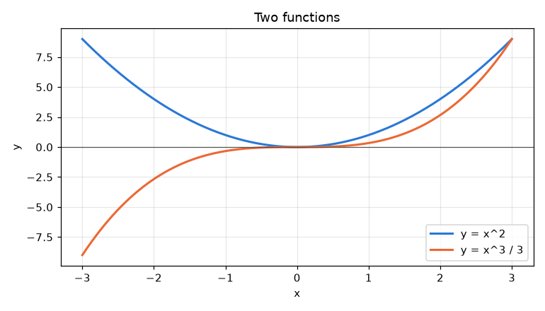

Лінія — це відрізки між точками. Для гладкої кривої функції беруть багато точок: `np.linspace(-3, 3, 200)`.

## Колір, товщина, стиль лінії, маркери

| Параметр | Приклади | Значення |
|---|---|---|
| `color` | `"#2a78d6"`, `"tab:blue"` | колір |
| `linewidth` (`lw`) | `1`, `2` | товщина в пунктах |
| `linestyle` (`ls`) | `"-"`, `"--"`, `":"`, `"-."` | суцільна, штрихова, точкова |
| `marker` | `"o"`, `"s"`, `"^"`, `"x"` | маркер у кожній точці |
| `markersize` (`ms`) | `6`, `8` | розмір маркера |
| `alpha` | `0.5` | прозорість |
| `label` | `"Olena"` | підпис для легенди |

```python
# Program: line styles and markers
import matplotlib.pyplot as plt
import numpy as np

x = np.arange(1, 8)
fig, ax = plt.subplots(figsize=(7, 4))
styles = [("-", "o", "solid + circles"), ("--", "s", "dashed + squares"), (":", "^", "dotted + triangles")]
for shift, (linestyle, marker, name) in enumerate(styles):
    ax.plot(x, x + shift * 3, color="#2a78d6", linewidth=2, linestyle=linestyle, marker=marker, markersize=8, label=name)
ax.set_title("Line styles and markers")
ax.grid(alpha=0.3)
ax.legend()
fig.tight_layout()
fig.savefig("styles.png", dpi=110)
print([line.get_linestyle() for line in ax.get_lines()])
```

```text
['-', '--', ':']
```

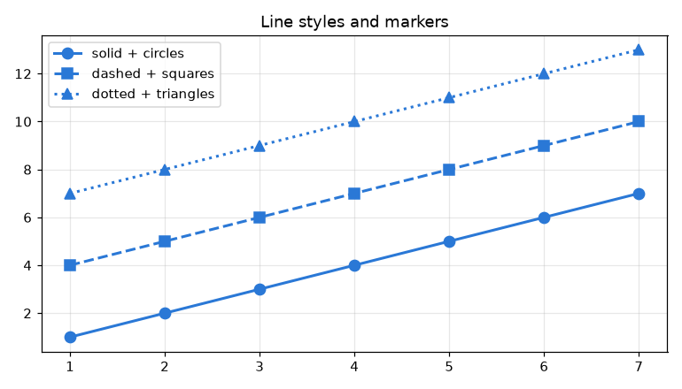

Маркери доречні, коли точок мало (до кількох десятків) і кожна — окреме вимірювання (день, місяць). На кривій з сотень точок маркери перетворюються на «гусеницю».

Стиль лінії — додатковий спосіб розрізнити ряди, крім кольору: графік зрозумілий і для людей з порушеннями кольорового зору, і після чорно-білого друку.

## Кілька рядів даних і фіксований порядок кольорів

Кожен ряд (людина, валюта, категорія) отримує **свій колір і зберігає його** на всіх графіках звіту. Кольори беруть з **фіксованої палітри в постійному порядку**, а не довільно:

```python
# File: palette.py
# Категоріальна палітра: порядок фіксований, кольори перевірено на розрізнюваність,
# зокрема для людей з порушеннями кольорового зору
CATEGORICAL = ["#2a78d6", "#eb6834", "#1baf7a", "#eda100", "#e87ba4", "#008300", "#6250d6", "#e34948"]
TEXT_SECONDARY = "#52514e"
GRID_ALPHA = 0.3


def color_for(name: str, names: list[str]) -> str:
    """The colour follows the entity: the same name always gets the same slot."""
    return CATEGORICAL[names.index(name) % len(CATEGORICAL)]
```

```python
# Program: the same currency keeps its colour on every chart
import matplotlib.pyplot as plt
import numpy as np

from palette import CATEGORICAL, color_for

CURRENCIES = ["USD", "EUR", "PLN"]
days = np.arange(1, 31)
rng = np.random.default_rng(1)
rates = {"USD": 44.5 + np.cumsum(rng.normal(0, 0.05, 30)),
         "EUR": 51.6 + np.cumsum(rng.normal(0, 0.07, 30)),
         "PLN": 12.1 + np.cumsum(rng.normal(0, 0.02, 30))}

fig, axes = plt.subplots(1, 2, figsize=(11, 4))
for code in ("USD", "EUR"):
    axes[0].plot(days, rates[code], color=color_for(code, CURRENCIES), linewidth=2, label=code)
axes[0].set_title("USD and EUR")
axes[1].plot(days, rates["EUR"], color=color_for("EUR", CURRENCIES), linewidth=2, label="EUR")
axes[1].set_title("only EUR - still the second colour")
for ax in axes:
    ax.set_xlabel("Day of September 2026")
    ax.set_ylabel("UAH per unit")
    ax.grid(alpha=0.3)
    ax.legend()
fig.tight_layout()
fig.savefig("fixed_colours.png", dpi=110)
print("EUR colour on both charts:", axes[0].get_lines()[1].get_color(), axes[1].get_lines()[0].get_color())
```

```text
EUR colour on both charts: #eb6834 #eb6834
```

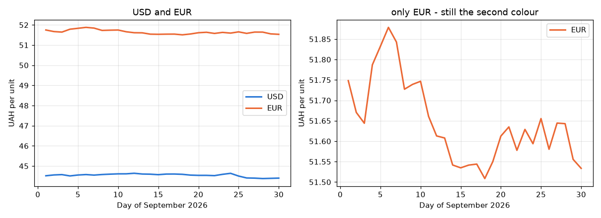

Якщо на другому графіку EUR став би синім (бо він там перший), читач вирішив би, що це USD. Колір прив'язують до **сутності**, а не до порядкового номера на конкретному графіку. Більше ніж 6–8 рядів на одному графіку не розрізнити: решту обʼєднують у «Other» або розносять на окремі графіки (лекція 43).

## Межі осей і початок з нуля

```python
# Program: the same data with a truncated and a zero-based axis
import matplotlib.pyplot as plt

months = ["Jul", "Aug", "Sep", "Oct"]
spent = [7200, 7300, 7350, 7500]
fig, axes = plt.subplots(1, 2, figsize=(10, 3.8), sharex=True)
for ax, title in zip(axes, ("y from 7150: looks like a jump", "y from 0: a small change")):
    ax.plot(months, spent, color="#2a78d6", linewidth=2, marker="o")
    ax.set_title(title)
    ax.set_ylabel("Amount, UAH")
    ax.grid(alpha=0.3)
axes[0].set_ylim(7150, 7550)
axes[1].set_ylim(0, 8000)
fig.tight_layout()
fig.savefig("axis_limits.png", dpi=110)
print("growth:", round((spent[-1] / spent[0] - 1) * 100, 1), "%")
```

```text
growth: 4.2 %
```

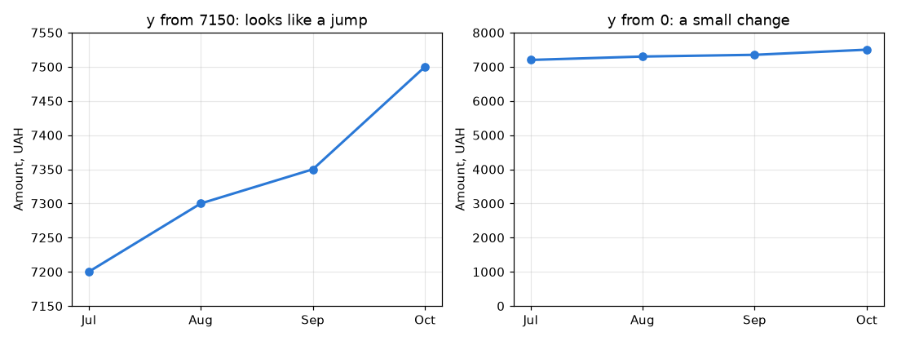

Зростання на 4 % на лівому графіку виглядає як злет у кілька разів. Для лінійних графіків обрізана вісь допустима, коли важливі саме **коливання** (курс валюти), але її межі мають бути видимими й підписаними. Для стовпців вісь **завжди** починається з нуля (лекція 41).

## Поділки та їхні підписи

`ax.set_xticks` задає положення поділок, `ax.set_xticklabels` — підписи, а **форматувальники** (`matplotlib.ticker`) — вигляд чисел:

```python
# Program: tick positions and number formatting
import matplotlib.pyplot as plt
from matplotlib.ticker import FuncFormatter, MultipleLocator, PercentFormatter

months = list(range(1, 13))
savings = [1200 * m for m in months]
share = [m / 12 for m in months]

fig, axes = plt.subplots(1, 2, figsize=(11, 4))
axes[0].plot(months, savings, color="#2a78d6", linewidth=2)
axes[0].xaxis.set_major_locator(MultipleLocator(1))
axes[0].yaxis.set_major_formatter(FuncFormatter(lambda value, pos: f"{value / 1000:.0f}k UAH"))
axes[0].set_title("Savings")
axes[1].plot(months, share, color="#2a78d6", linewidth=2)
axes[1].yaxis.set_major_formatter(PercentFormatter(xmax=1))
axes[1].set_xticks([1, 4, 7, 10], labels=["Jan", "Apr", "Jul", "Oct"])
axes[1].set_title("Share of the yearly goal")
for ax in axes:
    ax.grid(alpha=0.3)
fig.tight_layout()
fig.savefig("ticks.png", dpi=110)
fig.canvas.draw()
print([t.get_text() for t in axes[0].get_yticklabels()][1:4])
```

```text
['2k UAH', '4k UAH', '6k UAH']
```

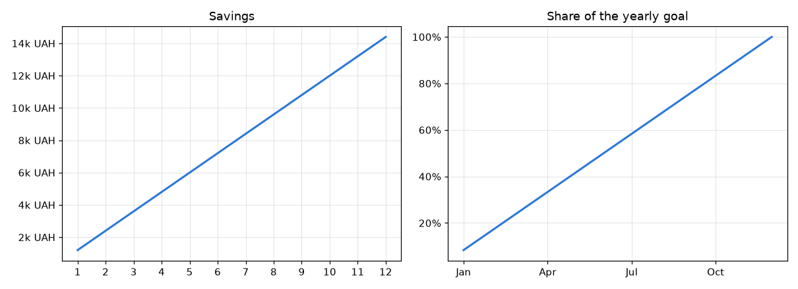

| Інструмент | Що робить |
|---|---|
| `MultipleLocator(1)` | поділка через кожну одиницю |
| `MaxNLocator(5)` | не більше 5 поділок |
| `PercentFormatter(xmax=1)` | `0.25` → `25%` |
| `FuncFormatter(f)` | будь-який формат функцією `f(value, pos)` |
| `StrMethodFormatter("{x:,.0f}")` | формат рядком |
| `ax.tick_params(axis="x", rotation=45)` | поворот підписів |

## Дати на осі X

Якщо по осі X — обʼєкти `datetime` чи стовпець дат pandas, matplotlib сам розставляє поділки-дати. Формат задають `matplotlib.dates`:

```python
# Program: dates on the x axis
from datetime import date, timedelta

import matplotlib.dates as mdates
import matplotlib.pyplot as plt
import numpy as np

days = [date(2026, 9, 1) + timedelta(days=i) for i in range(61)]
rng = np.random.default_rng(4)
spent = rng.uniform(50, 250, 61)
salary = np.where(np.arange(61) % 30 == 29, 6000, 0)  # зарплата 30 вересня і 30 жовтня
balance = 6000 + np.cumsum(salary - spent)

fig, ax = plt.subplots(figsize=(9, 4))
ax.plot(days, balance, color="#2a78d6", linewidth=2)
ax.xaxis.set_major_locator(mdates.WeekdayLocator(byweekday=mdates.MO))
ax.xaxis.set_major_formatter(mdates.DateFormatter("%d %b"))
ax.set_title("Card balance, September - October 2026")
ax.set_ylabel("UAH")
ax.grid(alpha=0.3)
fig.autofmt_xdate()
fig.tight_layout()
fig.savefig("dates.png", dpi=110)
fig.canvas.draw()
print("first ticks:", [t.get_text() for t in ax.get_xticklabels()][:3])
```

```text
first ticks: ['31 Aug', '07 Sep', '14 Sep']
```

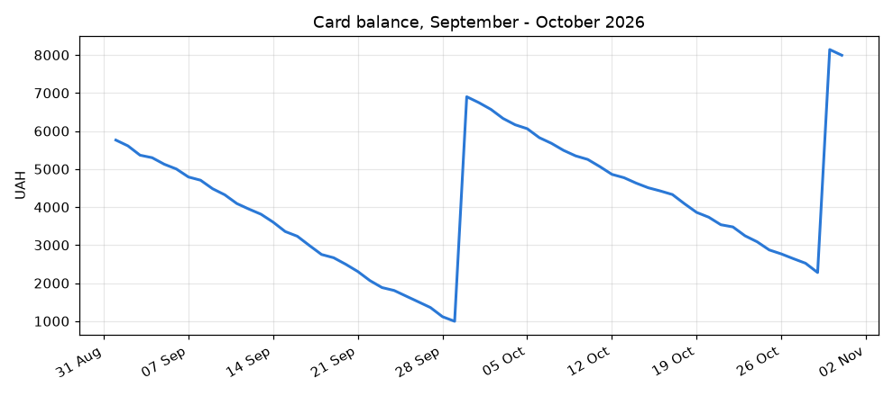

`fig.autofmt_xdate()` нахиляє підписи дат, щоб вони не накладалися.

## Логарифмічна шкала

Коли значення відрізняються на порядки (кількість користувачів застосунку: 10, 100, 10 000), на звичайній шкалі малі значення зливаються з нулем. **Логарифмічна шкала** робить рівні *відношення* однаковими відстанями: від 10 до 100 — стільки ж, скільки від 100 до 1000.

```python
# Program: linear and logarithmic scales for exponential growth
import matplotlib.pyplot as plt
import numpy as np

months = np.arange(0, 25)
users = 50 * 1.35 ** months
fig, axes = plt.subplots(1, 2, figsize=(10, 3.8))
for ax, scale in zip(axes, ("linear", "log")):
    ax.plot(months, users, color="#2a78d6", linewidth=2)
    ax.set_yscale(scale)
    ax.set_title(f"{scale} scale")
    ax.set_xlabel("Month")
    ax.set_ylabel("Users")
    ax.grid(alpha=0.3, which="both")
fig.tight_layout()
fig.savefig("log_scale.png", dpi=110)
print("users after 2 years:", round(users[-1]))
```

```text
users after 2 years: 67140
```

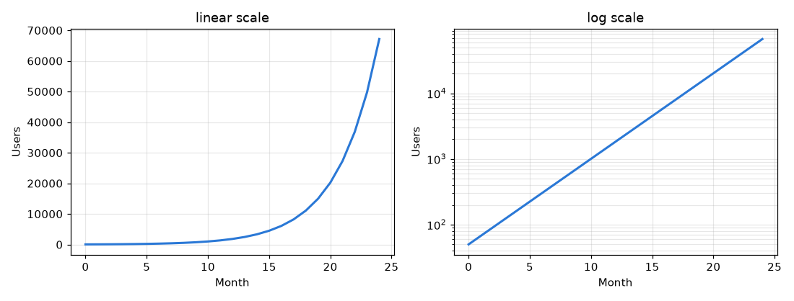

Експоненційне зростання на логарифмічній шкалі — пряма лінія: так одразу видно, чи темп зростання сталий. Логарифмічну шкалу обовʼязково позначають у підписі осі чи заголовку: читач, який цього не помітив, зробить неправильні висновки.

## Легенда та прямі підписи

| Параметр `legend` | Значення |
|---|---|
| `loc="upper left"`, `"best"` | розташування |
| `ncols=3` | кількість стовпців |
| `frameon=False` | без рамки |
| `title="Currency"` | заголовок легенди |
| `bbox_to_anchor=(1, 1)` | винести за межі графіка |

Коли рядів 2–4, зручно додати **прямі підписи** біля кінця кожної лінії: читачу не треба переводити погляд між лінією і легендою. Легенду при цьому залишають — вона потрібна тим, хто не розрізняє кольори:

```python
# Program: a legend and direct labels at the end of each line
import matplotlib.pyplot as plt
import numpy as np

from palette import CATEGORICAL, TEXT_SECONDARY

months = np.arange(1, 13)
series = {"food": 2800 + 60 * months, "fun": 600 + 25 * months, "transport": 450 + 5 * months}
fig, ax = plt.subplots(figsize=(8, 4.5))
for color, (name, values) in zip(CATEGORICAL, series.items()):
    ax.plot(months, values, color=color, linewidth=2, label=name)
    ax.annotate(f"{name} {values[-1]:.0f}", xy=(months[-1], values[-1]), xytext=(6, 0),
                textcoords="offset points", va="center", color=TEXT_SECONDARY)
ax.set_xlim(1, 14)
ax.set_title("Monthly expenses by category, 2026")
ax.set_xlabel("Month")
ax.set_ylabel("UAH")
ax.grid(alpha=0.3)
ax.legend(loc="upper left", frameon=False, ncols=3)
fig.tight_layout()
fig.savefig("direct_labels.png", dpi=110)
print("labels:", [t.get_text() for t in ax.texts])
```

```text
labels: ['food 3520', 'fun 900', 'transport 510']
```

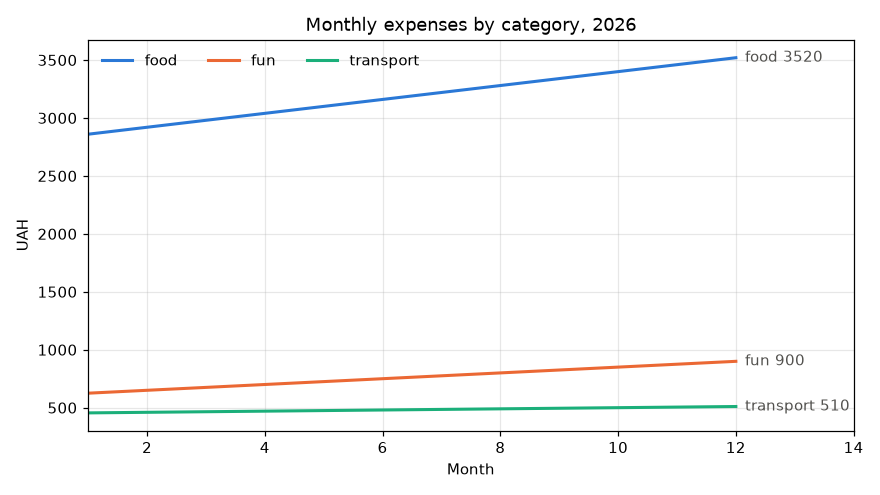

Підписи написано **нейтральним** темно-сірим кольором, а не кольором лінії: так текст однаково добре читається для всіх рядів, а колір несе лише лінія. Підпис — лише біля останньої точки, а не біля кожної: числа на всіх точках перетворюють графік на таблицю.

## Опорні лінії й області: `axhline`, `axvspan`, `fill_between`

| Метод | Що малює |
|---|---|
| `ax.axhline(y)` | горизонтальну лінію через увесь графік (ліміт, середнє) |
| `ax.axvline(x)` | вертикальну лінію (дата події) |
| `ax.axvspan(x1, x2)` | вертикальну смугу (вихідні, канікули) |
| `ax.fill_between(x, y1, y2)` | заливку між кривими (діапазон, похибка) |

```python
# Program: a budget limit, a holiday period and a range band
import matplotlib.pyplot as plt
import numpy as np

days = np.arange(1, 31)
rng = np.random.default_rng(12)
daily = rng.gamma(2, 50, 30)
cumulative = np.cumsum(daily)
low, high = cumulative * 0.9, cumulative * 1.1

fig, ax = plt.subplots(figsize=(8, 4.5))
ax.fill_between(days, low, high, color="#2a78d6", alpha=0.15, linewidth=0, label="forecast +-10%")
ax.plot(days, cumulative, color="#2a78d6", linewidth=2, label="spent so far")
ax.axhline(3000, color="#52514e", linestyle="--", linewidth=1, label="monthly limit")
ax.axvspan(10, 13, color="#52514e", alpha=0.08, label="holidays")
ax.set_title("Cumulative expenses, September 2026")
ax.set_xlabel("Day")
ax.set_ylabel("UAH")
ax.set_ylim(0)
ax.grid(alpha=0.3)
ax.legend(loc="lower right", frameon=False)
fig.tight_layout()
fig.savefig("reference_lines.png", dpi=110)
day_over = np.argmax(cumulative > 3000) + 1 if (cumulative > 3000).any() else None
print("total:", round(cumulative[-1], 2), "| limit passed on day:", day_over)
```

```text
total: 3152.62 | limit passed on day: 30
```

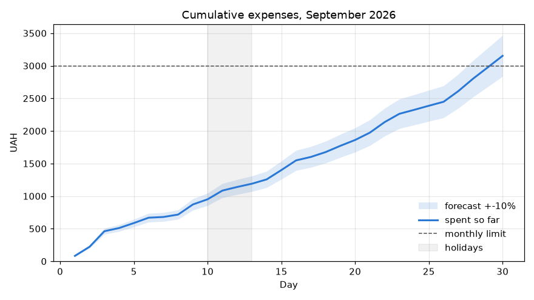

## Лінія тренду

Лінію тренду рахують методом найменших квадратів (лекція 29) і малюють поверх даних:

```python
# Program: data points with a fitted trend line
import matplotlib.pyplot as plt
import numpy as np

months = np.arange(1, 7)
spent = np.array([7200.0, 7450.0, 7300.0, 7900.0, 8100.0, 8350.0])
k, c = np.polyfit(months, spent, 1)
future = np.arange(1, 10)

fig, ax = plt.subplots(figsize=(7, 4))
ax.plot(months, spent, color="#2a78d6", linewidth=2, marker="o", markersize=8, label="actual")
ax.plot(future, k * future + c, color="#eb6834", linewidth=2, linestyle="--", label=f"trend: +{k:.0f} UAH/month")
ax.axvline(6.5, color="#52514e", linewidth=0.8)
ax.text(6.6, ax.get_ylim()[0] + 50, "forecast", color="#52514e")
ax.set_title("Monthly expenses and trend")
ax.set_xlabel("Month")
ax.set_ylabel("UAH")
ax.grid(alpha=0.3)
ax.legend(frameon=False)
fig.tight_layout()
fig.savefig("trend.png", dpi=110)
print(f"forecast for month 9: {k * 9 + c:.0f} UAH")
```

```text
forecast for month 9: 9021 UAH
```

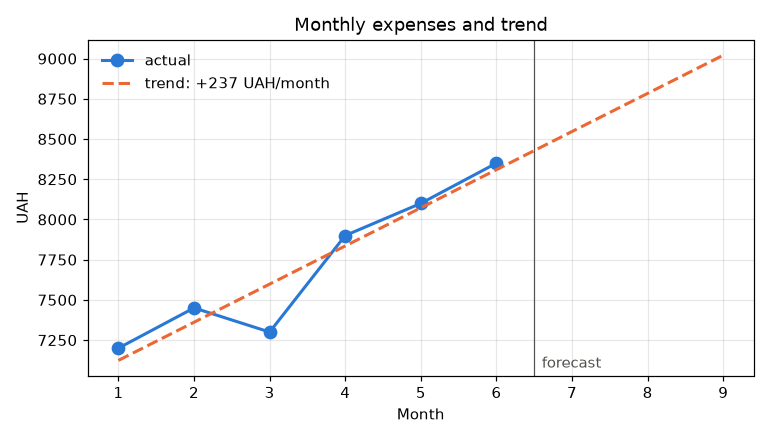

Прогноз позначено штриховою лінією й підписом: читач має бачити, де закінчуються дані й починається припущення.

## Стилі: `plt.style` і `rcParams`

**`rcParams`** — словник налаштувань за замовчуванням (шрифти, кольори, товщина ліній, сітка). Змінивши їх один раз на початку програми, отримують однаковий вигляд усіх графіків. Готові набори налаштувань — **стилі**:

```python
# Program: available styles and project-wide rcParams
import matplotlib.pyplot as plt
from cycler import cycler

print("some styles:", [s for s in plt.style.available if s in ("ggplot", "seaborn-v0_8-whitegrid", "fivethirtyeight")])
plt.rcParams.update({
    "figure.figsize": (8, 4.5),
    "axes.grid": True,
    "grid.alpha": 0.3,
    "axes.spines.top": False,
    "axes.spines.right": False,
    "lines.linewidth": 2,
    "axes.prop_cycle": cycler(color=["#2a78d6", "#eb6834", "#1baf7a", "#eda100"]),
})
fig, ax = plt.subplots()
for shift in range(3):
    ax.plot([1, 2, 3], [shift, shift + 1, shift + 0.5], label=f"series {shift + 1}")
ax.legend(frameon=False)
fig.savefig("rc_style.png", dpi=100)
print("first colours:", [line.get_color() for line in ax.get_lines()])
print("figure size:", fig.get_size_inches().tolist())
```

```text
some styles: ['fivethirtyeight', 'ggplot', 'seaborn-v0_8-whitegrid']
first colours: ['#2a78d6', '#eb6834', '#1baf7a']
figure size: [8.0, 4.5]
```

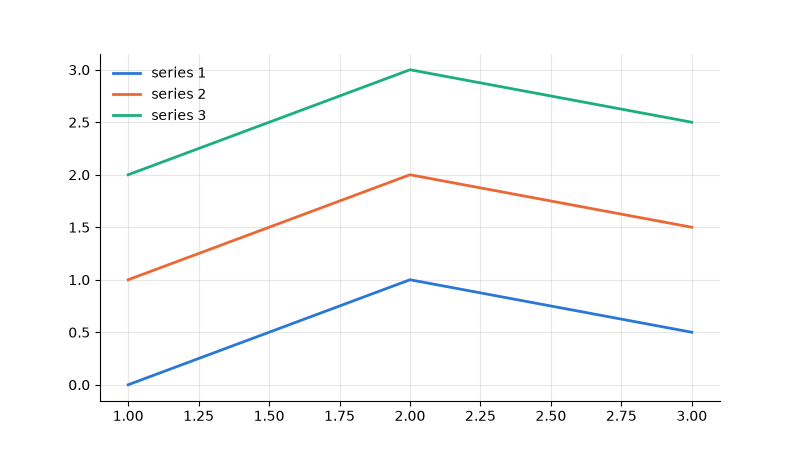

`axes.prop_cycle` задає порядок кольорів для рядів без явного `color=`. Приховані верхня й права рамки (`spines`) прибирають візуальний шум. Тимчасово змінити стиль для одного графіка можна блоком `with plt.style.context("ggplot"):`.

## Типові помилки

| Помилка | Чому погано | Як правильно |
|---|---|---|
| Лінія між категоріями (food → fun → transport) | лінія вигадує «проміжні» значення | стовпчикова діаграма |
| Колір ряду змінюється між графіками | читач плутає ряди | колір за сутністю, фіксована палітра |
| 10+ ліній на одному графіку | «спагеті», нічого не розібрати | виділити 2–3 головні, решта — сірим або окремими графіками |
| Обрізана вісь Y без пояснення | маленька зміна виглядає величезною | показувати межі або почати з нуля |
| Логарифмічна шкала без позначки | неправильне прочитання | підпис осі `log scale` |
| Числа біля кожної точки | графік перетворюється на таблицю | підписи лише важливих точок |
| Текст кольором ряду | погано читається для світлих кольорів | нейтральний колір тексту |
| Прогноз суцільною лінією як дані | вигадані значення виглядають фактами | штрихова лінія і підпис |
| Дві шкали Y (`twinx`) | масштаби довільні, легко ввести в оману | два графіки зі спільною віссю X |

## Підсумок

- Лінійний графік — для змін уздовж неперервної осі (час, функції); для категорій — стовпці.
- `ax.plot(x, y, color, linewidth, linestyle, marker, label)`; стиль лінії доповнює колір.
- Кольори рядів беруть з **фіксованої палітри**, і колір іде за сутністю на всіх графіках.
- `set_xlim`/`set_ylim`, `set_xticks`, форматувальники `matplotlib.ticker` і `matplotlib.dates` керують осями; `set_yscale("log")` — для даних різних порядків.
- Легенда обовʼязкова для кількох рядів; прямі підписи біля кінців ліній допомагають читати графік.
- `axhline`, `axvspan`, `fill_between` додають ліміти, періоди й діапазони; тренд — `np.polyfit`.
- `rcParams` і стилі задають однаковий вигляд усіх графіків проєкту.

## Корисні посилання

- [Matplotlib — `Axes.plot`](https://matplotlib.org/stable/api/_as_gen/matplotlib.axes.Axes.plot.html)
- [Matplotlib — Tick locating and formatting](https://matplotlib.org/stable/gallery/ticks/tick-locators.html)
- [Matplotlib — Date tick labels](https://matplotlib.org/stable/gallery/text_labels_and_annotations/date.html)
- [Matplotlib — Customizing with style sheets and rcParams](https://matplotlib.org/stable/users/explain/customizing.html)
- Wilke C. Fundamentals of Data Visualization. — O'Reilly, 2019. — [clauswilke.com/dataviz](https://clauswilke.com/dataviz/)
