# 39. (Л) Гістограми та scatter plots у matplotlib

## Зміст лекції

1. Розподіл і звʼязок: два питання до даних
2. Гістограма: `ax.hist`
3. Кількість і межі кошиків
4. Що показує форма гістограми
5. Середнє й медіана на гістограмі
6. Нормовані й накопичувальні гістограми
7. Порівняння двох розподілів
8. Точкова діаграма: `ax.scatter`
9. Розмір і колір точок
10. Категорії на точковій діаграмі
11. Багато точок: прозорість і `hexbin`
12. Лінія тренду й коефіцієнт кореляції
13. Розподіл і звʼязок разом
14. Типові помилки

## Розподіл і звʼязок: два питання до даних

| Питання | Графік |
|---|---|
| Які значення трапляються часто, а які рідко? Чи є викиди? | **гістограма** — розподіл однієї величини |
| Чи повʼязані дві величини? Як саме? | **точкова діаграма** (scatter) — звʼязок двох величин |

Обидва графіки — продовження статистики з лекції 30: гістограма — це `np.histogram` у вигляді малюнка, а точкова діаграма показує те, що кореляція описує одним числом.

## Гістограма: `ax.hist`

Гістограма ділить діапазон значень на **кошики** (bins) і показує висотою стовпця, скільки значень потрапило в кожен:

```python
# Program: a histogram of exam grades
import matplotlib.pyplot as plt
import numpy as np

rng = np.random.default_rng(30)
grades = np.clip(rng.normal(74, 11, 220), 0, 100)
fig, ax = plt.subplots(figsize=(7, 4))
counts, edges, bars = ax.hist(grades, bins=12, color="#2a78d6", edgecolor="white", linewidth=2)
ax.set_title("Exam grades of 220 students")
ax.set_xlabel("Grade")
ax.set_ylabel("Students")
ax.grid(alpha=0.3, axis="y")
fig.tight_layout()
fig.savefig("grades_hist.png", dpi=110)
print("bins:", len(counts), "| students counted:", int(counts.sum()), "| bin width:", round(edges[1] - edges[0], 2))
```

```text
bins: 12 | students counted: 220 | bin width: 5.26
```

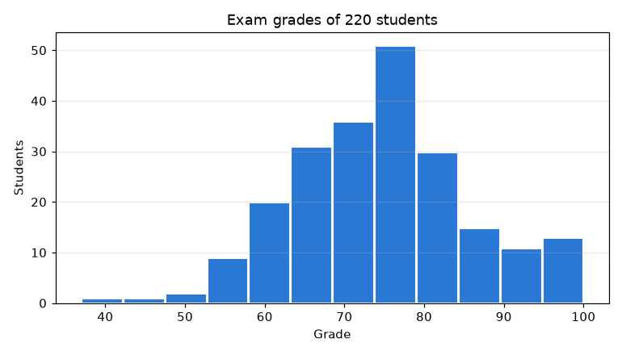

`ax.hist` повертає кількості, межі кошиків і намальовані стовпці. `edgecolor="white"` додає тонкий проміжок між стовпцями — так їх легше розрізнити.

## Кількість і межі кошиків

Вигляд гістограми сильно залежить від кількості кошиків:

```python
# Program: too few, reasonable and too many bins
import matplotlib.pyplot as plt
import numpy as np

rng = np.random.default_rng(30)
grades = np.clip(rng.normal(74, 11, 220), 0, 100)
fig, axes = plt.subplots(1, 3, figsize=(12, 3.5), sharey=False)
for ax, bins in zip(axes, (4, "auto", 80)):
    counts, edges, _ = ax.hist(grades, bins=bins, color="#2a78d6", edgecolor="white")
    ax.set_title(f"bins={bins} -> {len(counts)} bins")
    ax.set_xlabel("Grade")
axes[0].set_ylabel("Students")
fig.tight_layout()
fig.savefig("bins.png", dpi=100)
print("auto rule chose", len(np.histogram_bin_edges(grades, bins="auto")) - 1, "bins")
```

```text
auto rule chose 15 bins
```

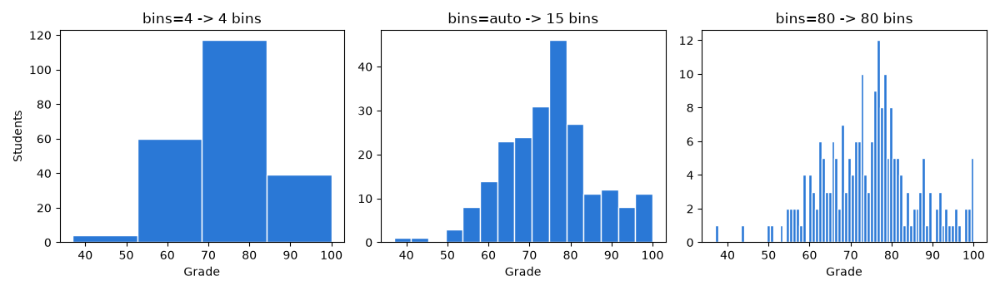

- **замало** кошиків приховують форму розподілу;
- **забагато** — перетворюють гістограму на «шум», бо в кожен кошик потрапляє 0–3 значення;
- `bins="auto"` обирає кількість за статистичними правилами — хороший початок.

Межі можна задати явно списком — так гістограма відповідає змістовим інтервалам, наприклад шкалі оцінювання:

```python
# Program: bins that follow the grading scale
import matplotlib.pyplot as plt
import numpy as np

rng = np.random.default_rng(30)
grades = np.clip(rng.normal(74, 11, 220), 0, 100)
edges = [0, 60, 64, 74, 82, 90, 100]
labels = ["F", "E", "D", "C", "B", "A"]
counts, _ = np.histogram(grades, bins=edges)
fig, ax = plt.subplots(figsize=(7, 4))
ax.hist(grades, bins=edges, color="#2a78d6", edgecolor="white", linewidth=2)
for left, right, label, n in zip(edges[:-1], edges[1:], labels, counts):
    ax.text((left + right) / 2, n, f"{label}\n{n}", ha="center", va="bottom", color="#52514e")
ax.set_title("Grades by ECTS scale")
ax.set_xlabel("Grade")
ax.set_ylabel("Students")
ax.set_ylim(0, counts.max() * 1.25)
fig.tight_layout()
fig.savefig("ects_hist.png", dpi=110)
print(dict(zip(labels, counts.tolist())))
```

```text
{'F': 20, 'E': 20, 'D': 62, 'C': 71, 'B': 25, 'A': 22}
```

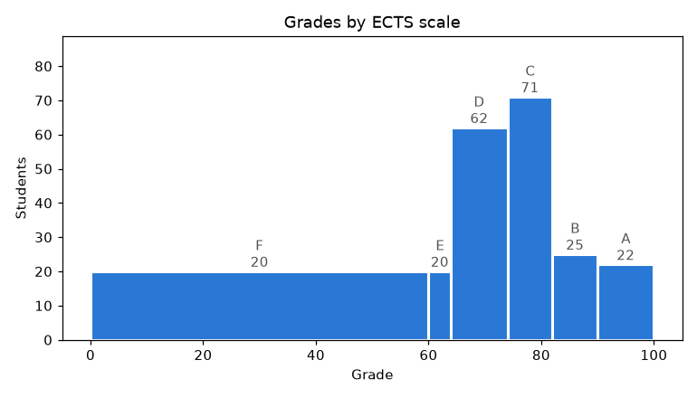

Коли кошики мають **різну ширину**, висота стовпця — кількість, але широкий стовпець «візуально важчий». У таких випадках порівнюють саме підписи чисел, або будують гістограму з `density=True` (див. нижче).

## Що показує форма гістограми

| Форма | Що означає | Приклад |
|---|---|---|
| симетричний «дзвін» | значення групуються навколо середнього | оцінки, зріст |
| довгий хвіст праворуч (правоскошений) | багато малих значень і кілька дуже великих | витрати, зарплати, ціни квартир |
| два «горби» (бімодальний) | змішано дві різні групи | оцінки двох груп з різною підготовкою |
| рівномірний | усі значення однаково часті | кидки кубика |
| окремий стовпець далеко від інших | викид або помилка даних | покупка ноутбука серед щоденних витрат |

```python
# Program: four typical distribution shapes
import matplotlib.pyplot as plt
import numpy as np

rng = np.random.default_rng(8)
shapes = {
    "symmetric": rng.normal(70, 10, 2000),
    "right skewed (expenses)": rng.lognormal(4, 0.7, 2000),
    "two groups": np.concatenate([rng.normal(60, 6, 1000), rng.normal(85, 5, 1000)]),
    "uniform (dice)": rng.integers(1, 7, 2000) + rng.uniform(-0.4, 0.4, 2000),
}
fig, axes = plt.subplots(1, 4, figsize=(14, 3.2))
for ax, (title, data) in zip(axes, shapes.items()):
    ax.hist(data, bins=30, color="#2a78d6", edgecolor="white", linewidth=0.5)
    ax.set_title(title)
    ax.set_yticks([])
fig.tight_layout()
fig.savefig("shapes.png", dpi=100)
skewed = shapes["right skewed (expenses)"]
print(f"skewed: mean {skewed.mean():.1f} > median {np.median(skewed):.1f}")
```

```text
skewed: mean 71.9 > median 55.5
```

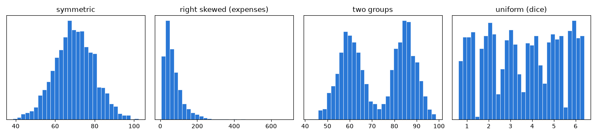

У правоскошеному розподілі середнє більше за медіану: довгий хвіст «тягне» середнє вгору (лекція 30).

## Середнє й медіана на гістограмі

Вертикальні лінії допомагають побачити, де «центр» розподілу:

```python
# Program: mark the mean and the median on a skewed histogram
import matplotlib.pyplot as plt
import numpy as np

rng = np.random.default_rng(21)
daily = rng.lognormal(4.2, 0.8, 365)
mean, median = daily.mean(), np.median(daily)
fig, ax = plt.subplots(figsize=(8, 4))
ax.hist(daily, bins=40, color="#2a78d6", edgecolor="white", linewidth=0.5)
ax.axvline(median, color="#52514e", linewidth=2, label=f"median {median:.0f} UAH")
ax.axvline(mean, color="#52514e", linewidth=2, linestyle="--", label=f"mean {mean:.0f} UAH")
ax.set_title("Daily expenses during a year")
ax.set_xlabel("UAH per day")
ax.set_ylabel("Days")
ax.legend(frameon=False)
fig.tight_layout()
fig.savefig("mean_median.png", dpi=110)
print(f"mean {mean:.0f}, median {median:.0f}, max {daily.max():.0f}")
```

```text
mean 84, median 64, max 429
```

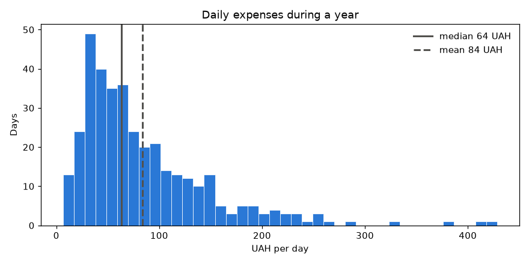

Дві лінії однакового нейтрального кольору розрізняються **стилем** (суцільна і штрихова) і підписами в легенді.

## Нормовані й накопичувальні гістограми

| Параметр | Вісь Y показує |
|---|---|
| за замовчуванням | кількість значень у кошику |
| `density=True` | щільність: площа всіх стовпців = 1 — можна порівнювати вибірки різного розміру |
| `cumulative=True` | скільки значень **не більші** за межу кошика |
| `histtype="step"` | лише контур — зручно накладати кілька гістограм |

```python
# Program: a cumulative histogram answers "how many days below X"
import matplotlib.pyplot as plt
import numpy as np
from matplotlib.ticker import PercentFormatter

rng = np.random.default_rng(21)
daily = rng.lognormal(4.2, 0.8, 365)
fig, ax = plt.subplots(figsize=(7, 4))
ax.ecdf(daily, color="#2a78d6", linewidth=2)  # накопичена частка без кошиків
ax.axhline(0.9, color="#52514e", linewidth=1, linestyle="--")
p90 = np.percentile(daily, 90)
ax.annotate(f"90% of days below {p90:.0f} UAH", xy=(p90, 0.9), xytext=(250, 0.7),
            arrowprops={"arrowstyle": "->", "color": "#52514e"}, color="#52514e")
ax.yaxis.set_major_formatter(PercentFormatter(xmax=1))
ax.set_title("Cumulative share of days")
ax.set_xlabel("UAH per day")
ax.set_ylabel("Share of days")
ax.grid(alpha=0.3)
fig.tight_layout()
fig.savefig("cumulative.png", dpi=110)
print(f"90th percentile: {p90:.0f} UAH")
```

```text
90th percentile: 161 UAH
```

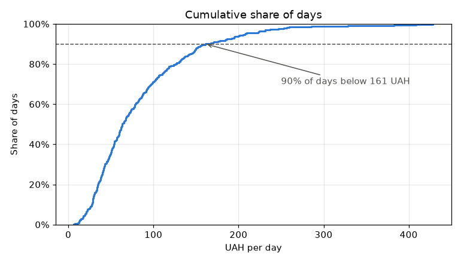

Накопичений розподіл можна побудувати й гістограмою `hist(..., cumulative=True, density=True, histtype="step")`, але метод `ax.ecdf` (matplotlib 3.8+) точніший: він не потребує кошиків і не малює зайвої вертикальної лінії наприкінці.

## Порівняння двох розподілів

Дві гістограми можна накласти з прозорістю, але перекриті області важко читати. Надійніше — **малі множини** (small multiples): окремі графіки зі **спільною віссю X**:

```python
# Program: compare two groups with small multiples and a shared axis
import matplotlib.pyplot as plt
import numpy as np

rng = np.random.default_rng(5)
groups = {"PZ-11": rng.normal(78, 8, 30), "PZ-12": rng.normal(70, 12, 30)}
bins = np.arange(40, 101, 5)
fig, axes = plt.subplots(2, 1, figsize=(7, 5), sharex=True, sharey=True)
for ax, color, (name, grades) in zip(axes, ["#2a78d6", "#eb6834"], groups.items()):
    ax.hist(grades, bins=bins, color=color, edgecolor="white", linewidth=2)
    ax.axvline(np.median(grades), color="#52514e", linewidth=2)
    ax.set_title(f"{name}: median {np.median(grades):.0f}", loc="left")
    ax.set_ylabel("Students")
axes[-1].set_xlabel("Grade")
fig.tight_layout()
fig.savefig("two_groups.png", dpi=110)
print({name: round(float(np.std(g, ddof=1)), 1) for name, g in groups.items()})
```

```text
{'PZ-11': 7.1, 'PZ-12': 12.4}
```

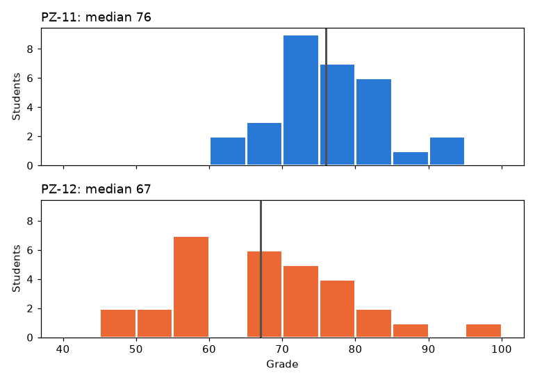

Спільні осі (`sharex`, `sharey`) обовʼязкові: інакше однакові на вигляд стовпці означатимуть різні числа.

## Точкова діаграма: `ax.scatter`

Точкова діаграма показує кожне спостереження точкою з координатами (x, y):

```python
# Program: study hours and grades
import matplotlib.pyplot as plt
import numpy as np

rng = np.random.default_rng(13)
hours = rng.uniform(1, 14, 60)
grades = np.clip(52 + 3.2 * hours + rng.normal(0, 6, 60), 0, 100)
fig, ax = plt.subplots(figsize=(7, 4.5))
ax.scatter(hours, grades, color="#2a78d6", s=40, edgecolors="white", linewidths=1)
ax.set_title("Study hours per week and exam grade")
ax.set_xlabel("Hours per week")
ax.set_ylabel("Grade")
ax.grid(alpha=0.3)
fig.tight_layout()
fig.savefig("scatter.png", dpi=110)
print("correlation:", round(np.corrcoef(hours, grades)[0, 1], 2))
```

```text
correlation: 0.92
```

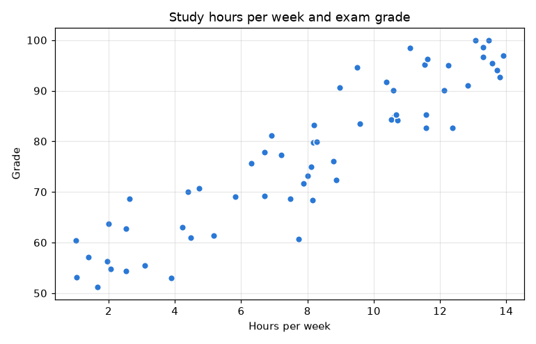

| Параметр | Значення |
|---|---|
| `s` | площа маркера в пунктах² (одне число або масив) |
| `c` / `color` | колір (одне значення або масив чисел для шкали) |
| `alpha` | прозорість |
| `marker` | форма: `"o"`, `"s"`, `"^"` |
| `edgecolors`, `linewidths` | обведення — розділяє точки, що перекриваються |

## Розмір і колір точок

Третю числову величину можна показати **кольором** (послідовна шкала одного відтінку: світлий — мало, темний — багато) або **розміром** точки:

```python
# Program: colour shows a third variable, size a fourth
import matplotlib.pyplot as plt
import numpy as np

rng = np.random.default_rng(13)
hours = rng.uniform(1, 14, 60)
grades = np.clip(52 + 3.2 * hours + rng.normal(0, 6, 60), 0, 100)
sleep = np.clip(8.5 - 0.15 * hours + rng.normal(0, 0.6, 60), 4, 10)
absences = rng.integers(0, 10, 60)

fig, ax = plt.subplots(figsize=(8, 4.8))
points = ax.scatter(hours, grades, c=sleep, cmap="Blues", vmin=4, vmax=10, s=20 + absences * 15,
                    edgecolors="#52514e", linewidths=0.5)
colorbar = fig.colorbar(points, ax=ax)
colorbar.set_label("Sleep, hours per night")
for size in (0, 5, 9):
    ax.scatter([], [], s=20 + size * 15, color="white", edgecolors="#52514e", label=f"{size} absences")
ax.legend(title="Point size", frameon=False, loc="lower right")
ax.set_title("Hours, grade, sleep and absences")
ax.set_xlabel("Hours per week")
ax.set_ylabel("Grade")
ax.grid(alpha=0.3)
fig.tight_layout()
fig.savefig("bubble.png", dpi=110)
print("colour range:", points.get_clim())
```

```text
colour range: (4.0, 10.0)
```

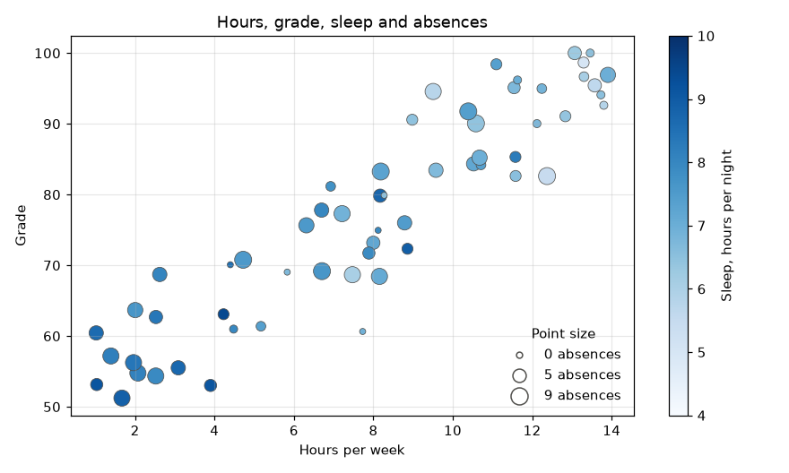

- **колірна шкала** (`colorbar`) — обовʼязкова «легенда» для кольору;
- шкала одного відтінку (`"Blues"`, `"viridis"`) для **величини**; веселкові шкали (`"jet"`, `"rainbow"`) спотворюють сприйняття: однакові різниці значень виглядають різними;
- для розміру точок легенду будують «порожніми» точками відомого розміру;
- розмір і колір — менш точні канали, ніж положення: найважливіші величини ставлять на осі X і Y.

## Категорії на точковій діаграмі

Групи (дисципліни, групи студентів) показують **категоріальними** кольорами з фіксованої палітри (лекція 37). На точковій діаграмі кожна точка може опинитися поруч з будь-якою іншою, тому кольори мають бути розрізнюваними **попарно всі** — для перевіреної палітри курсу це не більше трьох категорій. Для більшої кількості — малі множини:

```python
# Program: up to three groups by colour, plus marker shape as a second cue
import matplotlib.pyplot as plt
import numpy as np

rng = np.random.default_rng(9)
groups = {"PZ-11": (8, 55, "o"), "PZ-12": (6, 50, "s"), "KN-11": (10, 45, "^")}
colors = ["#2a78d6", "#eb6834", "#1baf7a"]
fig, ax = plt.subplots(figsize=(7, 4.5))
for color, (name, (mean_hours, base, marker)) in zip(colors, groups.items()):
    hours = rng.normal(mean_hours, 2, 25).clip(0)
    grades = np.clip(base + 3 * hours + rng.normal(0, 5, 25), 0, 100)
    ax.scatter(hours, grades, color=color, marker=marker, s=45, edgecolors="white", linewidths=1, label=name)
ax.set_title("Hours and grades in three groups")
ax.set_xlabel("Hours per week")
ax.set_ylabel("Grade")
ax.grid(alpha=0.3)
ax.legend(frameon=False)
fig.tight_layout()
fig.savefig("groups_scatter.png", dpi=110)
print("groups:", [t.get_text() for t in ax.get_legend().get_texts()])
```

```text
groups: ['PZ-11', 'PZ-12', 'KN-11']
```

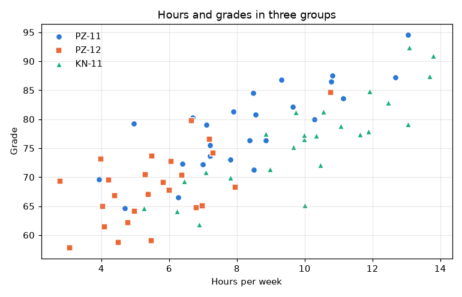

Форма маркера — **другий** спосіб розрізнити групи: графік зрозумілий і людям з порушеннями кольорового зору, і на чорно-білому друці.

## Багато точок: прозорість і `hexbin`

Коли точок тисячі, вони зливаються в пляму (**overplotting**), і щільність не видно. Допомагають прозорість, маленькі маркери або **шестикутна гістограма** `hexbin`, що рахує точки в комірках:

```python
# Program: overplotting with 20000 points and two remedies
import matplotlib.pyplot as plt
import numpy as np

rng = np.random.default_rng(2)
x = rng.normal(0, 1, 20_000)
y = 0.6 * x + rng.normal(0, 0.8, 20_000)
fig, axes = plt.subplots(1, 3, figsize=(13, 3.8), sharex=True, sharey=True)
axes[0].scatter(x, y, color="#2a78d6", s=10)
axes[0].set_title("plain: one big blob")
axes[1].scatter(x, y, color="#2a78d6", s=3, alpha=0.08, linewidths=0)
axes[1].set_title("small and transparent")
cells = axes[2].hexbin(x, y, gridsize=35, cmap="Blues", mincnt=1)
fig.colorbar(cells, ax=axes[2], label="points per cell")
axes[2].set_title("hexbin")
fig.tight_layout()
fig.savefig("overplotting.png", dpi=100)
print("hexbin cells with points:", int((cells.get_array() > 0).sum()))
```

```text
hexbin cells with points: 682
```

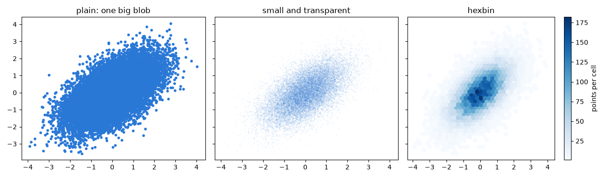

## Лінія тренду й коефіцієнт кореляції

```python
# Program: scatter with a trend line and the correlation in the title
import matplotlib.pyplot as plt
import numpy as np

rng = np.random.default_rng(13)
hours = rng.uniform(1, 14, 60)
grades = np.clip(52 + 3.2 * hours + rng.normal(0, 6, 60), 0, 100)
k, c = np.polyfit(hours, grades, 1)
r = np.corrcoef(hours, grades)[0, 1]
line_x = np.linspace(hours.min(), hours.max(), 2)

fig, ax = plt.subplots(figsize=(7, 4.5))
ax.scatter(hours, grades, color="#2a78d6", s=40, edgecolors="white", linewidths=1, label="students")
ax.plot(line_x, k * line_x + c, color="#52514e", linewidth=2, label=f"trend: +{k:.1f} points per hour")
ax.set_title(f"Study hours and grades (r = {r:.2f}, n = {hours.size})")
ax.set_xlabel("Hours per week")
ax.set_ylabel("Grade")
ax.grid(alpha=0.3)
ax.legend(frameon=False, loc="lower right")
fig.tight_layout()
fig.savefig("scatter_trend.png", dpi=110)
print(f"every extra hour: +{k:.2f} points")
```

```text
every extra hour: +3.41 points
```

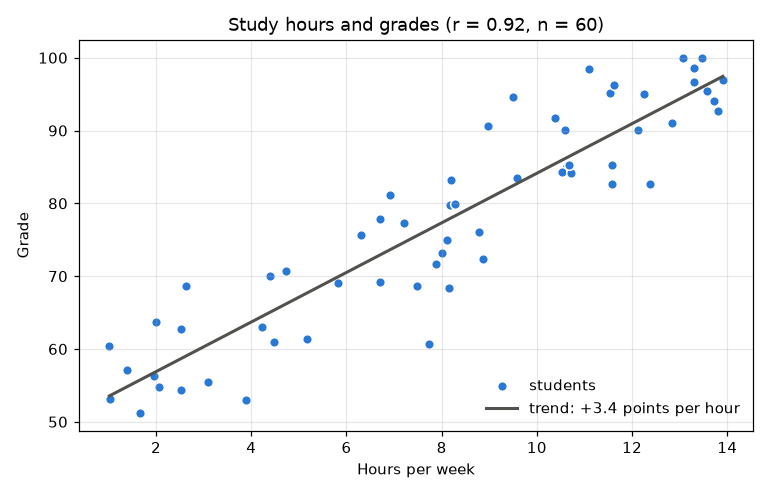

У заголовку вказано *r* і кількість спостережень *n*: кореляція на 5 точках і на 500 — різна за надійністю (лекція 30). І пам'ятайте: кореляція не доводить причинності.

## Розподіл і звʼязок разом

Точкову діаграму доповнюють гістограмами кожної величини по краях — так видно і звʼязок, і розподіли:

```python
# Program: a scatter plot with marginal histograms
import matplotlib.pyplot as plt
import numpy as np

rng = np.random.default_rng(13)
hours = rng.uniform(1, 14, 200)
grades = np.clip(52 + 3.2 * hours + rng.normal(0, 6, 200), 0, 100)
fig = plt.figure(figsize=(7, 6))
grid = fig.add_gridspec(2, 2, width_ratios=(4, 1), height_ratios=(1, 4), wspace=0.05, hspace=0.05)
ax = fig.add_subplot(grid[1, 0])
top = fig.add_subplot(grid[0, 0], sharex=ax)
right = fig.add_subplot(grid[1, 1], sharey=ax)
ax.scatter(hours, grades, color="#2a78d6", s=20, alpha=0.6, linewidths=0)
top.hist(hours, bins=20, color="#2a78d6", edgecolor="white")
right.hist(grades, bins=20, color="#2a78d6", edgecolor="white", orientation="horizontal")
top.tick_params(labelbottom=False)
right.tick_params(labelleft=False)
ax.set_xlabel("Hours per week")
ax.set_ylabel("Grade")
top.set_title("Hours and grades with their distributions")
fig.savefig("marginal.png", dpi=110, bbox_inches="tight")
print("axes on the figure:", len(fig.axes))
```

```text
axes on the figure: 3
```

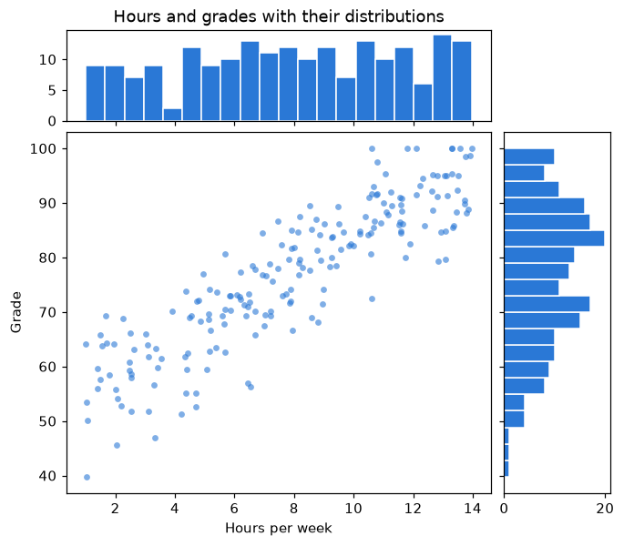

`fig.add_gridspec` створює сітку з комірками різного розміру: велика — для точкової діаграми, вузькі — для гістограм.

## Типові помилки

| Помилка | Чому погано | Як правильно |
|---|---|---|
| Гістограма з 3–4 кошиками | форма розподілу прихована | `bins="auto"` або змістові межі |
| Стовпці без проміжків | зливаються в суцільну масу | `edgecolor="white"` |
| Накладені гістограми без прозорості | одна закриває іншу | малі множини зі спільними осями |
| Порівняння вибірок різного розміру за кількостями | більша вибірка «виграє» | `density=True` |
| Веселкова шкала для величини | однакові різниці виглядають по-різному | шкала одного відтінку (`Blues`, `viridis`) |
| Колір точок без `colorbar` | невідомо, що означає колір | `fig.colorbar` з підписом |
| Багато категорій кольором на точковій діаграмі | кольори не розрізнити | до 3 кольорів + форма маркера; інакше малі множини |
| Тисячі непрозорих точок | щільність не видно | `alpha`, малі маркери, `hexbin` |
| Висновок про причину зі scatter | кореляція не є причинністю | обережні формулювання |

## Підсумок

- **Гістограма** (`ax.hist`) показує розподіл однієї величини; кількість і межі кошиків (`bins`) визначають, що на ній видно.
- Форма гістограми розповідає про дані: симетрія, скошеність, кілька груп, викиди; середнє й медіану позначають `axvline`.
- `density=True` порівнює вибірки різного розміру, `cumulative=True` відповідає на «скільки значень менші за X»; групи порівнюють малими множинами зі спільними осями.
- **Точкова діаграма** (`ax.scatter`) показує звʼязок двох величин; колір (з `colorbar`) і розмір додають третю й четверту.
- Категорії — до трьох кольорів з фіксованої палітри разом з формою маркера; тисячі точок — прозорість або `hexbin`.
- Лінію тренду рахують `np.polyfit`, у заголовку вказують *r* і *n*.

## Корисні посилання

- [Matplotlib — `Axes.hist`](https://matplotlib.org/stable/api/_as_gen/matplotlib.axes.Axes.hist.html)
- [Matplotlib — `Axes.scatter`](https://matplotlib.org/stable/api/_as_gen/matplotlib.axes.Axes.scatter.html)
- [Matplotlib — Choosing Colormaps](https://matplotlib.org/stable/users/explain/colors/colormaps.html)
- [Matplotlib — Scatter plot with histograms](https://matplotlib.org/stable/gallery/lines_bars_and_markers/scatter_hist.html)
- Wilke C. Fundamentals of Data Visualization. — Розділи «Visualizing distributions», «Visualizing associations».
