# 41. (Л) Стовпчикові діаграми, стеки, boxplots та інші типи графіків у matplotlib

## Зміст лекції

1. Стовпчикова діаграма: порівняння категорій
2. Вертикальні й горизонтальні стовпці
3. Сортування і нульова базова лінія
4. Підписи значень: `bar_label`
5. Згруповані стовпці
6. Складені стовпці (стеки)
7. Частки: стовпці 100 % і кругова діаграма
8. Похибки: `yerr`
9. «Ящик з вусами»: `boxplot`
10. Скрипкові діаграми: `violinplot`
11. Площі й сходинки: `stackplot`, `step`
12. Комбінований звіт на одній фігурі
13. Як обрати тип графіка
14. Типові помилки

## Стовпчикова діаграма: порівняння категорій

Стовпчикова діаграма порівнює **величини окремих категорій**: витрати за категоріями, кількість студентів у групах, продажі за місяцями. Довжину стовпців око порівнює точніше, ніж кути, площі чи відтінки кольору.

```python
# Program: totals by category as a bar chart
import matplotlib.pyplot as plt

categories = ["food", "fun", "transport", "health"]
totals = [4970.0, 1095.0, 72.5, 120.0]
fig, ax = plt.subplots(figsize=(7, 4))
bars = ax.bar(categories, totals, color="#2a78d6", width=0.6)
ax.set_title("Expenses by category, September - October 2026")
ax.set_ylabel("UAH")
ax.grid(alpha=0.3, axis="y")
ax.set_axisbelow(True)
fig.tight_layout()
fig.savefig("bar.png", dpi=110)
print("bars:", len(bars), "| highest:", categories[totals.index(max(totals))])
```

```text
bars: 4 | highest: food
```

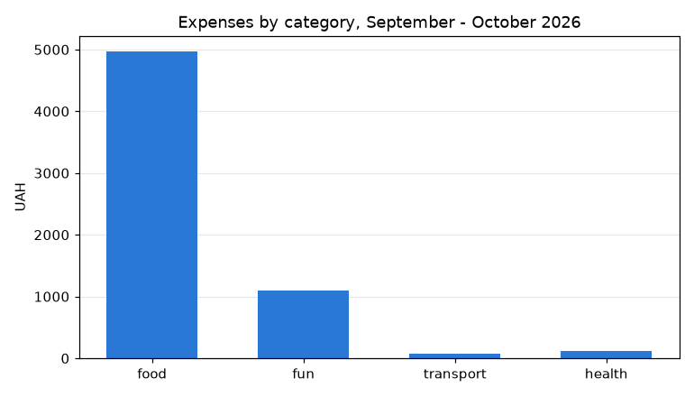

`ax.set_axisbelow(True)` малює сітку **під** стовпцями, а `axis="y"` залишає лише горизонтальні лінії — вертикальні тут нічого не додають.

| Параметр `bar` | Значення |
|---|---|
| `x`, `height` | категорії й значення |
| `width` | ширина стовпця (частка відстані між категоріями) |
| `bottom` | де починається стовпець (для стеків) |
| `color`, `edgecolor`, `linewidth` | заливка й обведення |
| `label` | підпис для легенди |

## Вертикальні й горизонтальні стовпці

Довгі назви категорій під вертикальними стовпцями доводиться нахиляти — їх важко читати. **Горизонтальні** стовпці (`barh`) розвʼязують проблему: назви пишуться рядками ліворуч.

```python
# Program: horizontal bars for long category names
import matplotlib.pyplot as plt

names = ["Groceries and household", "Cafes and restaurants", "Public transport", "Mobile and internet",
         "Books and courses", "Cinema and concerts"]
values = [3275.5, 845.0, 72.5, 250.0, 480.0, 1095.0]
order = sorted(range(len(values)), key=values.__getitem__)  # від меншого до більшого
fig, ax = plt.subplots(figsize=(8, 4))
ax.barh([names[i] for i in order], [values[i] for i in order], color="#2a78d6", height=0.6)
ax.set_title("Where the money went in September")
ax.set_xlabel("UAH")
ax.grid(alpha=0.3, axis="x")
ax.set_axisbelow(True)
fig.tight_layout()
fig.savefig("barh.png", dpi=110)
print("top category:", names[order[-1]])
```

```text
top category: Groceries and household
```

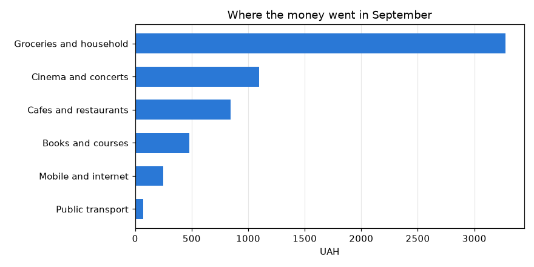

`barh` малює першу категорію **знизу**, тому для порядку «найбільше зверху» дані сортують за зростанням.

## Сортування і нульова базова лінія

Два правила стовпчикових діаграм:

1. **Вісь значень починається з нуля.** Довжина стовпця і є значенням; обрізана вісь робить різницю 4 % схожою на різницю в рази (лекція 37). matplotlib для `bar` сам починає вісь з нуля — не змінюйте цього `set_ylim`.
2. **Категорії без природного порядку сортують за значенням** — так одразу видно лідерів. Природний порядок (місяці, дні тижня, оцінки A–F) зберігають.

## Підписи значень: `bar_label`

Коли точні числа важливі, їх пишуть біля стовпців. Підписи — нейтральним кольором тексту, а не кольором стовпця:

```python
# Program: value labels on bars
import matplotlib.pyplot as plt

months = ["Jul", "Aug", "Sep", "Oct"]
spent = [7200, 7450, 7350, 7900]
fig, ax = plt.subplots(figsize=(7, 4))
bars = ax.bar(months, spent, color="#2a78d6", width=0.6)
ax.bar_label(bars, labels=[f"{v:,}".replace(",", " ") for v in spent], padding=3, color="#52514e")
ax.set_title("Monthly expenses")
ax.set_ylabel("UAH")
ax.set_ylim(0, max(spent) * 1.15)
ax.spines[["top", "right"]].set_visible(False)
fig.tight_layout()
fig.savefig("bar_labels.png", dpi=110)
print([t.get_text() for t in ax.texts])
```

```text
['7 200', '7 450', '7 350', '7 900']
```

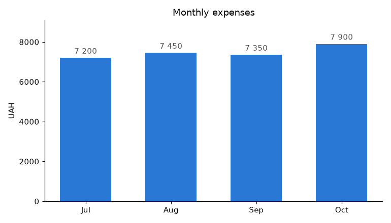

`set_ylim(0, max * 1.15)` залишає місце для підписів над найвищим стовпцем. Тисячі розділено пробілом — так записують числа в українській традиції.

## Згруповані стовпці

Щоб порівняти **дві ознаки** — наприклад, категорії у двох місяцях, — стовпці групують: для кожної категорії поруч стоять стовпці кожного місяця. Положення стовпців обчислюють вручну зсувом від центру:

```python
# Program: grouped bars for two months
import matplotlib.pyplot as plt
import numpy as np

categories = ["food", "fun", "transport", "health"]
data = {"September": [3275.5, 315.0, 42.5, 0.0], "October": [1694.5, 780.0, 30.0, 120.0]}
colors = ["#2a78d6", "#eb6834"]
x = np.arange(len(categories))
width = 0.38
fig, ax = plt.subplots(figsize=(8, 4.2))
for i, (color, (month, values)) in enumerate(zip(colors, data.items())):
    offset = (i - (len(data) - 1) / 2) * width
    bars = ax.bar(x + offset, values, width, color=color, edgecolor="white", linewidth=2, label=month)
    ax.bar_label(bars, fmt="%.0f", padding=2, color="#52514e", fontsize=8)
ax.set_xticks(x, categories)
ax.set_title("Expenses by category and month")
ax.set_ylabel("UAH")
ax.legend(frameon=False)
ax.grid(alpha=0.3, axis="y")
ax.set_axisbelow(True)
fig.tight_layout()
fig.savefig("grouped.png", dpi=110)
print("bar centres for September:", np.round(x - width / 2, 2).tolist())
```

```text
bar centres for September: [-0.19, 0.81, 1.81, 2.81]
```

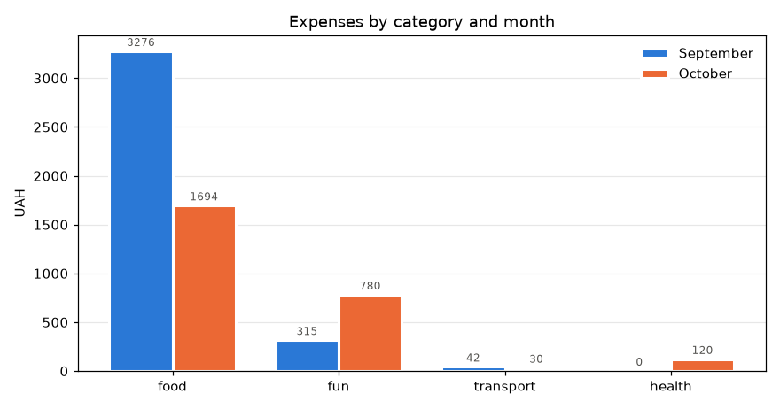

Біле обведення (`edgecolor="white"`, `linewidth=2`) відокремлює сусідні стовпці різних кольорів. Згрупованими стовпцями порівнюють 2–4 ряди; більше — краще малі множини.

## Складені стовпці (стеки)

**Складені** стовпці показують і **загальну суму**, і **внесок** кожної частини. Кожен наступний шар малюють з `bottom=` — накопиченою висотою попередніх:

```python
# Program: stacked bars show the total and its parts
import matplotlib.pyplot as plt
import numpy as np

months = ["Jul", "Aug", "Sep", "Oct"]
parts = {"food": [3100, 2950, 3275.5, 1694.5], "fun": [400, 950, 315, 780], "transport": [300, 280, 42.5, 30]}
colors = ["#2a78d6", "#eb6834", "#1baf7a"]
fig, ax = plt.subplots(figsize=(7, 4.5))
bottom = np.zeros(len(months))
for color, (name, values) in zip(colors, parts.items()):
    ax.bar(months, values, bottom=bottom, color=color, width=0.6, edgecolor="white", linewidth=2, label=name)
    bottom += values
for x, total in enumerate(bottom):
    ax.text(x, total + 60, f"{total:.0f}", ha="center", color="#52514e")
ax.set_title("Monthly expenses by category")
ax.set_ylabel("UAH")
ax.set_ylim(0, bottom.max() * 1.12)
ax.legend(frameon=False, loc="upper right", ncols=3)
ax.spines[["top", "right"]].set_visible(False)
fig.tight_layout()
fig.savefig("stacked.png", dpi=110)
print("totals:", bottom.tolist())
```

```text
totals: [3800.0, 4180.0, 3633.0, 2504.5]
```

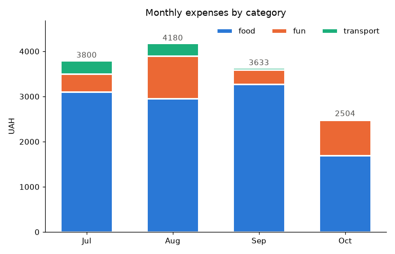

Точно порівняти можна лише **нижній** шар і загальну суму: верхні шари не мають спільної базової лінії. Тому найважливішу категорію кладуть знизу, а шарів роблять небагато (до 4–5).

## Частки: стовпці 100 % і кругова діаграма

Якщо важливі **частки**, а не суми, кожен стовпець нормують до 100 %:

```python
# Program: 100 percent stacked bars and a pie chart of the same data
import matplotlib.pyplot as plt
import numpy as np
from matplotlib.ticker import PercentFormatter

months = ["Jul", "Aug", "Sep", "Oct"]
parts = {"food": np.array([3100, 2950, 3275.5, 1694.5]), "fun": np.array([400, 950, 315, 780]),
         "transport": np.array([300, 280, 42.5, 30])}
colors = ["#2a78d6", "#eb6834", "#1baf7a"]
totals = sum(parts.values())

fig, (left, right) = plt.subplots(1, 2, figsize=(11, 4.2))
bottom = np.zeros(len(months))
for color, (name, values) in zip(colors, parts.items()):
    share = values / totals
    left.bar(months, share, bottom=bottom, color=color, width=0.6, edgecolor="white", linewidth=2, label=name)
    bottom += share
left.yaxis.set_major_formatter(PercentFormatter(xmax=1))
left.set_title("Share of categories by month")
left.legend(frameon=False, loc="upper center", bbox_to_anchor=(0.5, -0.08), ncols=3)

october = [values[-1] for values in parts.values()]
right.pie(october, labels=list(parts), colors=colors, autopct="%1.0f%%", startangle=90, counterclock=False,
          wedgeprops={"edgecolor": "white", "linewidth": 2}, textprops={"color": "#0b0b0b"})
right.set_title("October")
fig.tight_layout()
fig.savefig("shares.png", dpi=110)
print("October shares:", [f"{v / sum(october):.1%}" for v in october])
```

```text
October shares: ['67.7%', '31.1%', '1.2%']
```

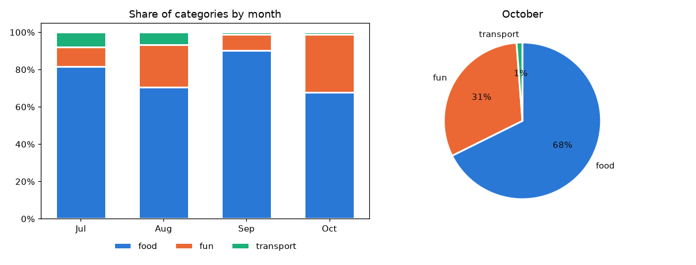

**Кругова діаграма** допустима лише для однієї сукупності з 2–4 частинами, які разом складають 100 %. Кути й площі око порівнює погано: дві частки 31 % і 35 % на круговій діаграмі виглядають однаково, а на стовпцях різниця видна одразу. Кілька кругових діаграм поруч для порівняння — погана ідея: краще стовпці 100 %.

## Похибки: `yerr`

Коли стовпець — середнє з вимірювань, показують і **розкид**: стандартне відхилення чи довірчий інтервал. Параметр `yerr` малює «вуса»:

```python
# Program: mean grades with standard deviation as error bars
import matplotlib.pyplot as plt
import numpy as np

rng = np.random.default_rng(4)
groups = {"PZ-11": rng.normal(78, 6, 28), "PZ-12": rng.normal(72, 12, 30), "KN-11": rng.normal(75, 8, 25)}
means = [g.mean() for g in groups.values()]
stds = [g.std(ddof=1) for g in groups.values()]
fig, ax = plt.subplots(figsize=(6, 4))
ax.bar(list(groups), means, yerr=stds, capsize=6, color="#2a78d6", width=0.55,
       error_kw={"ecolor": "#52514e", "linewidth": 1.5})
ax.set_title("Mean grade by group (whiskers: one standard deviation)")
ax.set_ylabel("Grade")
ax.set_ylim(0, 100)
ax.grid(alpha=0.3, axis="y")
ax.set_axisbelow(True)
fig.tight_layout()
fig.savefig("error_bars.png", dpi=110)
print({name: f"{m:.1f} +- {s:.1f}" for name, m, s in zip(groups, means, stds)})
```

```text
{'PZ-11': '77.4 +- 6.6', 'PZ-12': '71.2 +- 11.2', 'KN-11': '74.8 +- 8.4'}
```

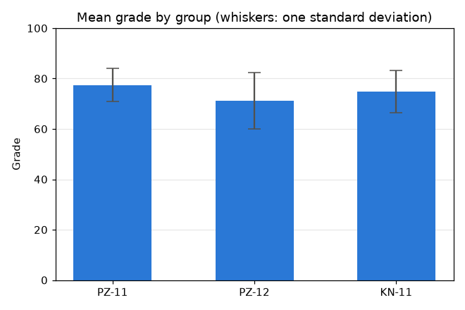

У підписі обовʼязково пояснюють, що означають «вуса»: стандартне відхилення, стандартну похибку чи довірчий інтервал — це різні речі.

## «Ящик з вусами»: `boxplot`

**Діаграма розмаху** (box plot, «ящик з вусами») стисло показує розподіл через квартилі (лекція 30):


- **ящик** — від першого до третього квартиля: середні 50 % значень;
- **лінія в ящику** — медіана;
- **вуса** — до найдальших значень у межах 1,5 · IQR від ящика;
- **окремі точки** — викиди.

```python
# Program: box plots compare distributions of several groups
import matplotlib.pyplot as plt
import numpy as np

rng = np.random.default_rng(4)
groups = {"PZ-11": rng.normal(78, 6, 28), "PZ-12": np.append(rng.normal(72, 12, 29), 22),
          "KN-11": rng.normal(75, 8, 25)}
fig, ax = plt.subplots(figsize=(7, 4.2))
result = ax.boxplot(list(groups.values()), tick_labels=list(groups), widths=0.5, patch_artist=True,
                    boxprops={"facecolor": "#cfe0f5", "edgecolor": "#2a78d6"},
                    medianprops={"color": "#0b0b0b", "linewidth": 2},
                    whiskerprops={"color": "#52514e"}, capprops={"color": "#52514e"},
                    flierprops={"marker": "o", "markerfacecolor": "#e34948", "markeredgecolor": "white", "markersize": 8})
ax.set_title("Grades by group")
ax.set_ylabel("Grade")
ax.grid(alpha=0.3, axis="y")
ax.set_axisbelow(True)
fig.tight_layout()
fig.savefig("boxplot.png", dpi=110)
outliers = [line.get_ydata().round(1).tolist() for line in result["fliers"]]
print("medians:", [round(float(np.median(g)), 1) for g in groups.values()], "| outliers:", outliers)
```

```text
medians: [77.7, 68.8, 74.4] | outliers: [[91.5], [22.0], []]
```

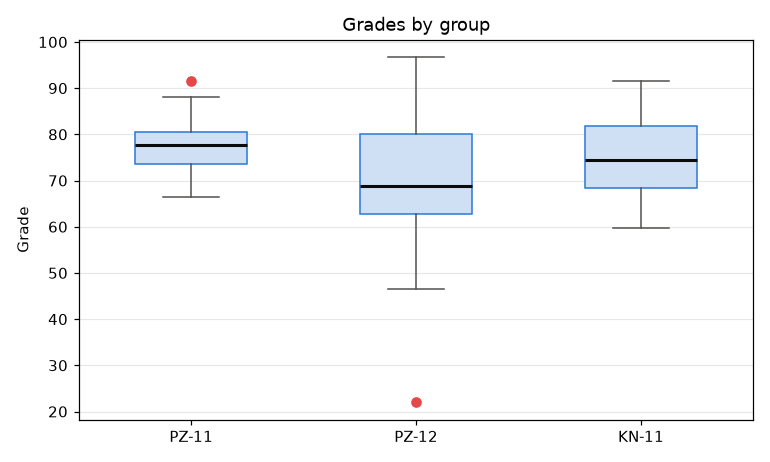

Діаграма розмаху займає мало місця, тому зручна для порівняння **багатьох** груп поруч. Але вона приховує форму розподілу: два «горби» на ній не видно.

## Скрипкові діаграми: `violinplot`

**Скрипкова діаграма** показує форму розподілу згладженою «щільністю» — ніби гістограму, повернуту набік і віддзеркалену:

```python
# Program: violin plots show the shape that box plots hide
import matplotlib.pyplot as plt
import numpy as np

rng = np.random.default_rng(6)
one_peak = rng.normal(75, 8, 300)
two_peaks = np.concatenate([rng.normal(62, 5, 150), rng.normal(88, 4, 150)])
fig, (box, violin) = plt.subplots(1, 2, figsize=(10, 4), sharey=True)
box.boxplot([one_peak, two_peaks], tick_labels=["group A", "group B"], widths=0.5)
box.set_title("box plot: groups look alike")
parts = violin.violinplot([one_peak, two_peaks], showmedians=True)
for body in parts["bodies"]:
    body.set_facecolor("#2a78d6")
    body.set_alpha(0.5)
violin.set_xticks([1, 2], ["group A", "group B"])
violin.set_title("violin plot: group B has two peaks")
box.set_ylabel("Grade")
fig.tight_layout()
fig.savefig("violin.png", dpi=110)
print("medians:", round(float(np.median(one_peak)), 1), round(float(np.median(two_peaks)), 1))
```

```text
medians: 76.0 75.7
```

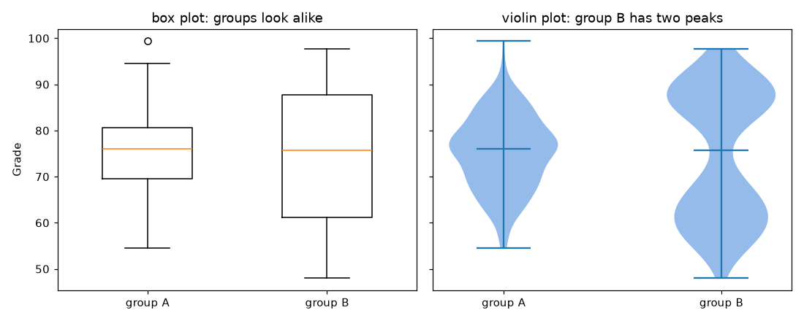

Медіани й ящики схожі, а скрипкова діаграма показує, що у групі B дві підгрупи — сильні й слабкі студенти.

## Площі й сходинки: `stackplot`, `step`

| Метод | Для чого |
|---|---|
| `ax.stackplot(x, *ys)` | складені площі: внесок частин у суму в часі |
| `ax.step(x, y, where="post")` | сходинки: значення змінюється стрибком (тарифи, залишок на рахунку) |

```python
# Program: a stacked area chart and a step chart
import matplotlib.pyplot as plt
import numpy as np

months = np.arange(1, 13)
food = 2800 + 50 * months
fun = 600 + 120 * np.sin(months / 2) + 30 * months
transport = np.full(12, 450.0)
tariff_months = [1, 4, 7, 10, 13]
tariff = [8.0, 8.0, 10.0, 12.0, 12.0]

fig, (area, steps) = plt.subplots(1, 2, figsize=(11, 4))
area.stackplot(months, food, fun, transport, labels=["food", "fun", "transport"],
               colors=["#2a78d6", "#eb6834", "#1baf7a"], edgecolor="white", linewidth=2)
area.set_title("Expenses by category, 2026")
area.set_ylabel("UAH")
area.legend(frameon=False, loc="upper left", ncols=3)
area.set_ylim(0, 6000)
steps.step(tariff_months, tariff, where="post", color="#2a78d6", linewidth=2)
steps.set_title("Public transport fare")
steps.set_ylabel("UAH per trip")
steps.set_ylim(0, 14)
for ax in (area, steps):
    ax.set_xlabel("Month")
    ax.grid(alpha=0.3)
fig.tight_layout()
fig.savefig("area_step.png", dpi=110)
print("December total:", round(food[-1] + fun[-1] + transport[-1], 1))
```

```text
December total: 4776.5
```

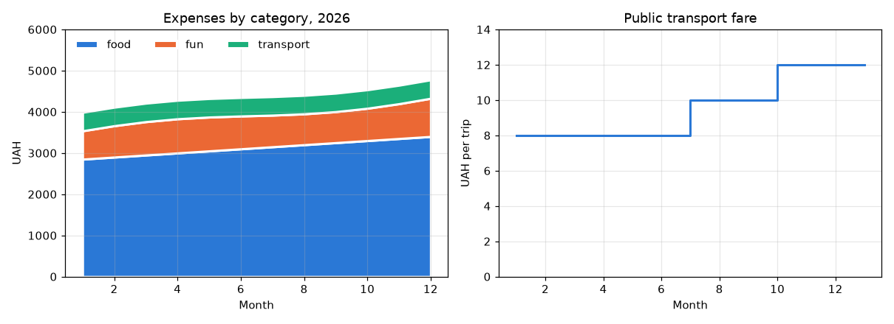

## Комбінований звіт на одній фігурі

Кілька різних графіків на одній фігурі — **панель** (dashboard): кожен відповідає на своє питання, а всі разом розповідають історію:

```python
# Program: a small report with four different charts
from datetime import date

import matplotlib.pyplot as plt
import numpy as np

rng = np.random.default_rng(42)
days = np.arange(1, 31)
daily = rng.gamma(2, 45, 30)
categories = ["food", "fun", "transport", "health"]
totals = [1650.0, 690.0, 310.0, 120.0]

fig, axes = plt.subplots(2, 2, figsize=(11, 7))
(trend, bars), (hist, box) = axes
trend.plot(days, np.cumsum(daily), color="#2a78d6", linewidth=2)
trend.axhline(3000, color="#52514e", linestyle="--", linewidth=1)
trend.set_title("1. Cumulative spending vs limit")
trend.set_xlabel("Day")
order = np.argsort(totals)
bars.barh(np.array(categories)[order], np.array(totals)[order], color="#2a78d6", height=0.6)
bars.set_title("2. Where the money went")
hist.hist(daily, bins=12, color="#2a78d6", edgecolor="white")
hist.set_title("3. How big a usual day is")
hist.set_xlabel("UAH per day")
weekday = np.array([date(2026, 9, day).weekday() for day in days])  # 0 - Monday
box.boxplot([daily[weekday < 5], daily[weekday >= 5]], tick_labels=["weekdays", "weekend"], widths=0.5)
box.set_title("4. Weekdays vs weekend")
for ax in axes.flat:
    ax.grid(alpha=0.3)
    ax.set_axisbelow(True)
    ax.spines[["top", "right"]].set_visible(False)
fig.suptitle("Expenses report, September 2026", fontsize=14)
fig.tight_layout()
fig.savefig("report.png", dpi=100)
print(f"spent {daily.sum():.0f} UAH, median day {np.median(daily):.0f} UAH")
```

```text
spent 2517 UAH, median day 82 UAH
```

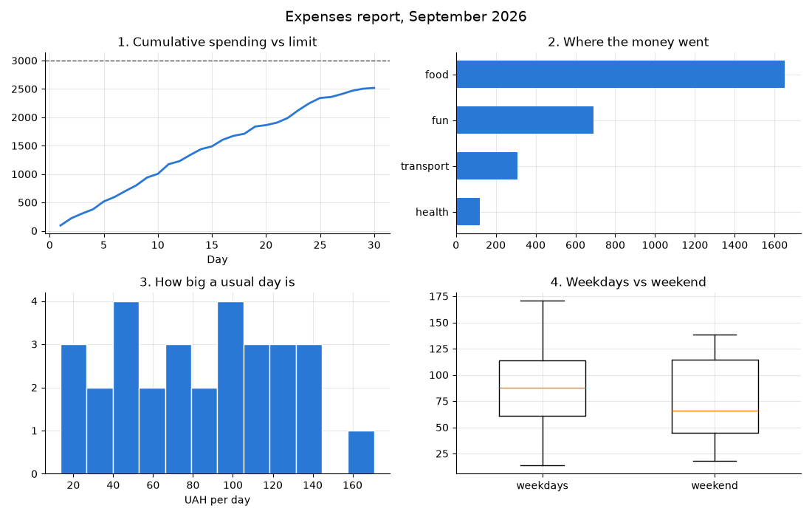

Пронумеровані заголовки-питання підказують порядок читання. Детально про оформлення — лекція 43.

## Як обрати тип графіка

| Питання до даних | Графік |
|---|---|
| Як змінюється величина в часі? | лінійний (`plot`) |
| Яка категорія більша? | стовпці (`bar`, `barh`), відсортовані |
| Як категорії порівнюються у двох-трьох вимірах? | згруповані стовпці або малі множини |
| Яка сума і з чого вона складається? | складені стовпці, `stackplot` |
| Які частки цілого? | стовпці 100 %; кругова — лише для 2–4 частин |
| Як розподілені значення? | гістограма, скрипкова діаграма |
| Як розподіли відрізняються між групами? | `boxplot`, `violinplot` |
| Чи повʼязані дві величини? | точкова діаграма |
| Одне головне число? | не графік, а великий напис із числом і порівнянням |

## Типові помилки

| Помилка | Чому погано | Як правильно |
|---|---|---|
| Вісь стовпців не з нуля | різниця виглядає в рази більшою | нульова базова лінія |
| Невпорядковані категорії | лідерів не видно | сортувати за значенням |
| Нахилені довгі підписи | важко читати | `barh` |
| Число на кожному стовпці без потреби | шум | `bar_label` лише там, де важливі точні значення |
| Багато шарів у стеку | середні шари неможливо порівняти | до 4–5 шарів, головний — знизу |
| Кругова діаграма з 8 частинами | кути не порівняти | стовпці |
| Кілька кругових діаграм поруч | порівняння неточне | стовпці 100 % |
| `yerr` без пояснення | невідомо, що означають вуса | підпис «std», «95% CI» |
| Тривимірні стовпці | перспектива спотворює довжини | лише 2D |

## Підсумок

- **Стовпці** порівнюють категорії: вісь з нуля, сортування за значенням, `barh` для довгих назв, `bar_label` для точних чисел.
- **Згруповані** стовпці порівнюють дві ознаки, **складені** — показують суму і внесок частин; частки — стовпці 100 %, кругова діаграма лише для кількох частин.
- `yerr` показує розкид середніх; підпис пояснює, що означають вуса.
- **`boxplot`** стисло порівнює розподіли груп через квартилі й викиди, **`violinplot`** показує їхню форму.
- `stackplot` — складені площі в часі, `step` — величини, що змінюються стрибком.
- Тип графіка обирають за питанням до даних; кілька графіків поєднують у звіт.

## Корисні посилання

- [Matplotlib — Grouped bar chart with labels](https://matplotlib.org/stable/gallery/lines_bars_and_markers/barchart.html)
- [Matplotlib — Stacked bar chart](https://matplotlib.org/stable/gallery/lines_bars_and_markers/bar_stacked.html)
- [Matplotlib — Box plots and violin plots](https://matplotlib.org/stable/gallery/statistics/boxplot_vs_violin.html)
- [From Data to Viz — вибір типу графіка](https://www.data-to-viz.com/)
- Wilke C. Fundamentals of Data Visualization. — Розділи «Visualizing amounts», «Visualizing proportions».
