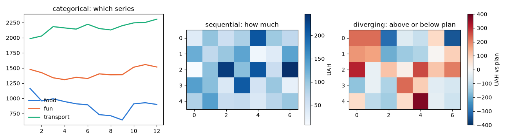
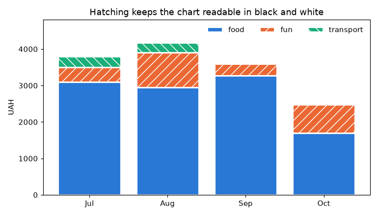
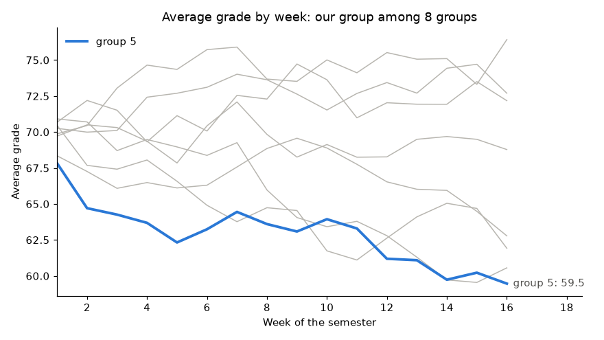
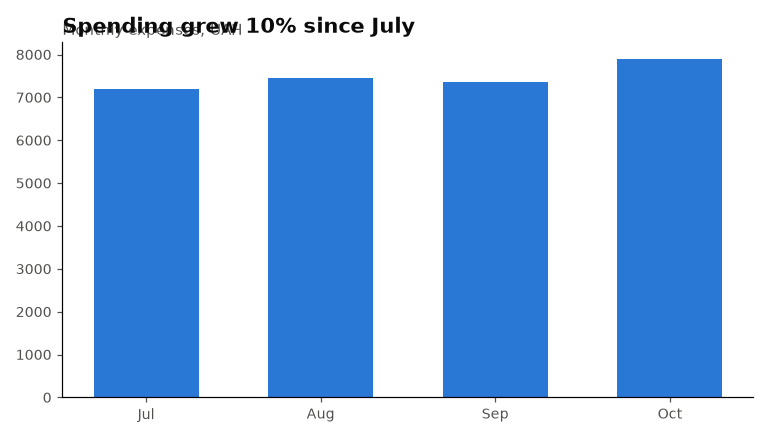
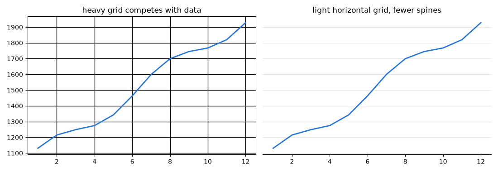
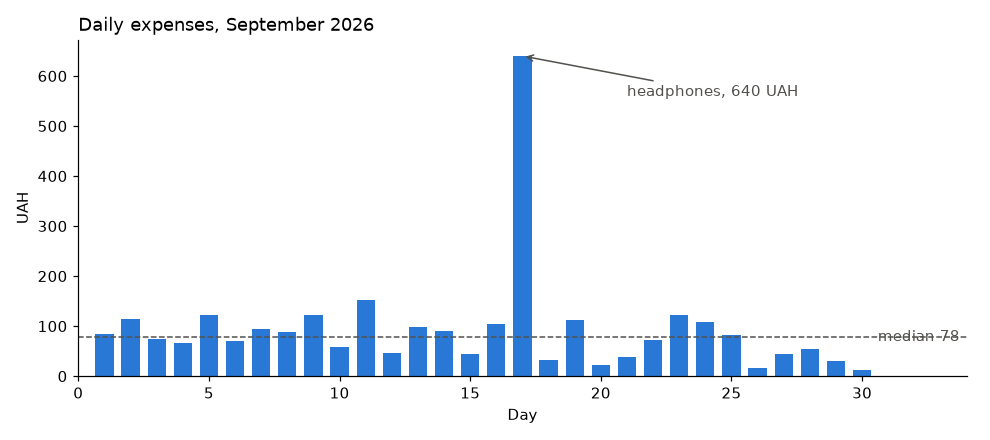
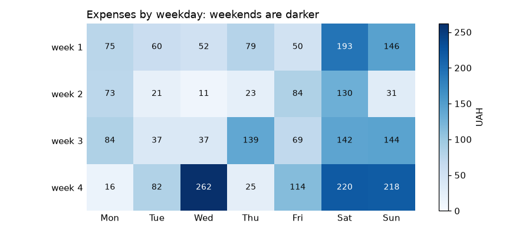
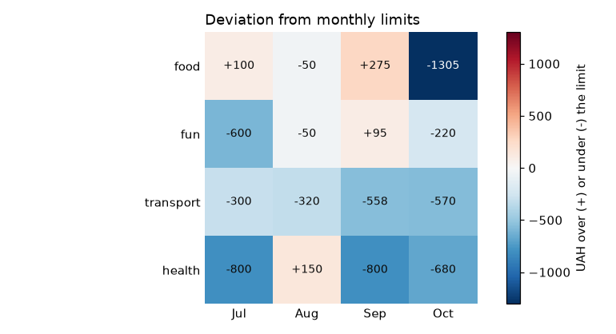
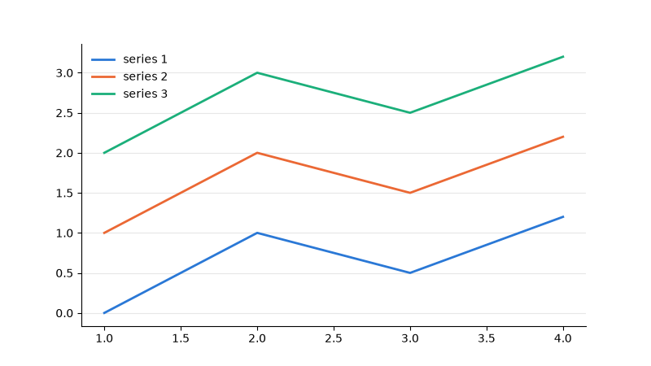
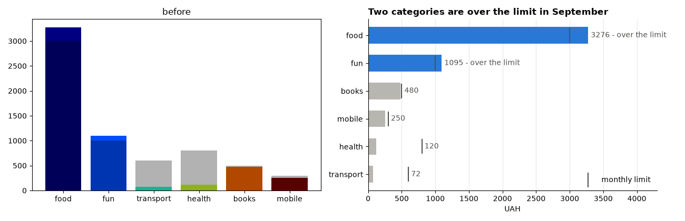

# 43. (Л) Налаштування кольорів, стилів, шрифтів, сітки, анотацій

## Зміст лекції

1. Від «працює» до «зрозуміло»
2. Як задавати кольори
3. Колір за задачею: категорії, величина, полярність, стан
4. Колірні карти (colormaps)
5. Колір для всіх: порушення кольорового зору
6. Акцент: один ряд кольором, решта сірим
7. Шрифти й розміри тексту
8. Сітка й рамки
9. Анотації: `annotate` і `text`
10. Теплова карта: `imshow` з підписами
11. Розбіжна шкала з нейтральним центром
12. Власний стиль проєкту: файл `.mplstyle`
13. Було — стало: переробка графіка
14. Контрольний список якісного графіка
15. Типові помилки

## Від «працює» до «зрозуміло»

Графік, побудований за замовчуванням, показує дані, але читачеві доводиться самому шукати головне. Оформлення — не прикраса, а **спосіб вести увагу**: що головне, що контекст, що можна пропустити.

| Елемент | Роль |
|---|---|
| дані (лінії, стовпці, точки) | головне — найбільш контрастні |
| підписи осей, заголовок | пояснюють, що на графіку |
| сітка, рамки, поділки | допоміжні — світлі й тонкі |
| анотації | вказують на важливе: рекорд, подію, ліміт |

## Як задавати кольори

| Спосіб | Приклад |
|---|---|
| шістнадцятковий код | `"#2a78d6"` |
| назва | `"black"`, `"white"` |
| палітра Tableau | `"tab:blue"`, `"tab:orange"` |
| RGB(A) кортеж | `(0.16, 0.47, 0.84)`, `(0.16, 0.47, 0.84, 0.5)` |
| відтінок сірого | `"0.3"` — рядок з числом від 0 (чорний) до 1 (білий) |
| колірна карта | `plt.colormaps["Blues"](0.7)` |

```python
# Program: different ways to specify the same colour
from matplotlib.colors import to_hex, to_rgb

for color in ("#2a78d6", (0.165, 0.471, 0.839), "tab:blue", "0.3"):
    print(f"{str(color):<22} -> {to_hex(color)}  rgb {tuple(round(c, 2) for c in to_rgb(color))}")
```

```text
#2a78d6                -> #2a78d6  rgb (0.16, 0.47, 0.84)
(0.165, 0.471, 0.839)  -> #2a78d6  rgb (0.17, 0.47, 0.84)
tab:blue               -> #1f77b4  rgb (0.12, 0.47, 0.71)
0.3                    -> #4c4c4c  rgb (0.3, 0.3, 0.3)
```

## Колір за задачею: категорії, величина, полярність, стан

Колір обирають не «за смаком», а **за тим, що він має показати**:

| Задача кольору | Що показує | Яка палітра | Приклад |
|---|---|---|---|
| **категоріальна** | який це ряд | різні відтінки у **фіксованому порядку** | food, fun, transport |
| **послідовна** | скільки | **один** відтінок від світлого до темного | витрати за днями на календарі |
| **розбіжна** | більше чи менше за опорне значення | **два** відтінки + нейтральний сірий у центрі | відхилення від бюджету |
| **стан** | добре чи погано | зарезервовані кольори + значок і текст | «перевищено ліміт» |

```python
# File: palette.py
# Перевірена палітра курсу: порядок фіксований
CATEGORICAL = ["#2a78d6", "#eb6834", "#1baf7a", "#eda100", "#e87ba4", "#008300", "#6250d6", "#e34948"]
TEXT_PRIMARY = "#0b0b0b"
TEXT_SECONDARY = "#52514e"
CONTEXT_GRAY = "#b8b6b0"
SEQUENTIAL = "Blues"  # величина: один відтінок
DIVERGING = "RdBu_r"  # полярність: два відтінки з білим центром
```

```python
# Program: one figure, three colour jobs
import matplotlib.pyplot as plt
import numpy as np

from palette import CATEGORICAL, DIVERGING, SEQUENTIAL

rng = np.random.default_rng(3)
fig, axes = plt.subplots(1, 3, figsize=(13, 3.6))
for slot, name in enumerate(["food", "fun", "transport"]):
    axes[0].plot(np.arange(1, 13), 1000 + slot * 500 + rng.normal(0, 80, 12).cumsum(), color=CATEGORICAL[slot],
                 linewidth=2, label=name)
axes[0].legend(frameon=False)
axes[0].set_title("categorical: which series")
image = axes[1].imshow(rng.gamma(2, 50, (5, 7)), cmap=SEQUENTIAL)
fig.colorbar(image, ax=axes[1], label="UAH")
axes[1].set_title("sequential: how much")
deviation = rng.normal(0, 150, (5, 7))
image = axes[2].imshow(deviation, cmap=DIVERGING, vmin=-400, vmax=400)
fig.colorbar(image, ax=axes[2], label="UAH vs plan")
axes[2].set_title("diverging: above or below plan")
fig.tight_layout()
fig.savefig("colour_jobs.png", dpi=100)
print("categorical slots used:", [line.get_color() for line in axes[0].get_lines()])
```

```text
categorical slots used: ['#2a78d6', '#eb6834', '#1baf7a']
```



Правила:

- категоріальні кольори беруть **по порядку** з палітри, і колір іде за сутністю на всіх графіках (лекція 37);
- для **величини** — один відтінок; «веселка» (`jet`, `rainbow`) створює межі, яких у даних немає;
- у розбіжній шкалі центр **нейтральний** (білий чи сірий), а не ще один колір;
- червоний і зелений для «погано/добре» лише разом з підписом або значком: їх не розрізняють люди з найпоширенішим типом порушення кольорового зору.

## Колірні карти (colormaps)

| Тип | Приклади | Для чого |
|---|---|---|
| послідовні однотонні | `Blues`, `Greens`, `Greys`, `Oranges` | величина від 0 до максимуму |
| послідовні перцептивно рівномірні | `viridis`, `cividis`, `magma` | величина; однакові кроки виглядають однаково |
| розбіжні | `RdBu_r`, `PuOr`, `BrBG` | відхилення від центру |
| якісні | `tab10` | категорії |

Суфікс `_r` перевертає шкалу: `RdBu_r` — від синього (мало) до червоного (багато).

```python
# Program: sample colours from colormaps
import matplotlib.pyplot as plt
from matplotlib.colors import to_hex

for name in ("Blues", "viridis", "RdBu_r"):
    cmap = plt.colormaps[name]
    print(f"{name:<8}", [to_hex(cmap(x)) for x in (0.0, 0.5, 1.0)])
```

```text
Blues    ['#f7fbff', '#6aaed6', '#08306b']
viridis  ['#440154', '#21918c', '#fde725']
RdBu_r   ['#053061', '#f7f6f6', '#67001f']
```

## Колір для всіх: порушення кольорового зору

Приблизно кожен дванадцятий чоловік має порушення кольорового зору (найчастіше важко розрізнити червоний і зелений). Графік має бути зрозумілим і для них, і після чорно-білого друку:

| Прийом | Як |
|---|---|
| перевірена палітра | палітра курсу перевірена на розрізнюваність сусідніх кольорів |
| не лише колір | стиль лінії, форма маркера, штрихування, підписи |
| легенда і прямі підписи | ряд впізнається за текстом |
| мало категорій | до 6–8 на лінійному, до 3 на точковому графіку (лекція 39) |
| контраст із фоном | світлі кольори (жовтий) — з підписами біля даних |

```python
# Program: hatching as a second cue in stacked bars
import matplotlib.pyplot as plt
import numpy as np

from palette import CATEGORICAL

months = ["Jul", "Aug", "Sep", "Oct"]
parts = {"food": [3100, 2950, 3275.5, 1694.5], "fun": [400, 950, 315, 780], "transport": [300, 280, 42.5, 30]}
hatches = ["", "//", "\\\\"]
fig, ax = plt.subplots(figsize=(7, 4))
bottom = np.zeros(4)
for color, hatch, (name, values) in zip(CATEGORICAL, hatches, parts.items()):
    ax.bar(months, values, bottom=bottom, color=color, hatch=hatch, edgecolor="white", linewidth=2, label=name)
    bottom += values
ax.set_title("Hatching keeps the chart readable in black and white")
ax.set_ylabel("UAH")
ax.legend(frameon=False, ncols=3, loc="upper right")
ax.set_ylim(0, bottom.max() * 1.15)
fig.tight_layout()
fig.savefig("hatching.png", dpi=110)
print("hatches:", [str(p.get_hatch() or "none") for p in ax.patches[::4]])
```

```text
hatches: ['none', '//', '\\\\']
```



## Акцент: один ряд кольором, решта сірим

Коли рядів багато, а важливий один (ваша група, ваш місяць), його виділяють кольором, а решту роблять **сірим контекстом**:

```python
# Program: highlight one series, keep the rest as grey context
import matplotlib.pyplot as plt
import numpy as np

from palette import CATEGORICAL, CONTEXT_GRAY, TEXT_SECONDARY

rng = np.random.default_rng(10)
weeks = np.arange(1, 17)
groups = {f"group {n}": 70 + rng.normal(0, 1.5, 16).cumsum() for n in range(1, 9)}
mine = "group 5"
fig, ax = plt.subplots(figsize=(8, 4.5))
for name, values in groups.items():
    if name != mine:
        ax.plot(weeks, values, color=CONTEXT_GRAY, linewidth=1)
ax.plot(weeks, groups[mine], color=CATEGORICAL[0], linewidth=2.5, label=mine)
ax.annotate(f"{mine}: {groups[mine][-1]:.1f}", xy=(weeks[-1], groups[mine][-1]), xytext=(6, 0),
            textcoords="offset points", va="center", color=TEXT_SECONDARY)
ax.set_xlim(1, 18.5)
ax.set_title("Average grade by week: our group among 8 groups")
ax.set_xlabel("Week of the semester")
ax.set_ylabel("Average grade")
ax.legend(frameon=False, loc="upper left")
ax.spines[["top", "right"]].set_visible(False)
fig.tight_layout()
fig.savefig("highlight.png", dpi=110)
rank = sorted(groups, key=lambda g: groups[g][-1], reverse=True).index(mine) + 1
print(f"{mine} is number {rank} of {len(groups)} at the end")
```

```text
group 5 is number 8 of 8 at the end
```



Вісім кольорових ліній читач розглядав би по черзі. Сірий контекст і один колір одразу відповідають на питання «де ми серед інших».

## Шрифти й розміри тексту

| Налаштування | Що змінює |
|---|---|
| `rcParams["font.size"]` | базовий розмір тексту |
| `rcParams["font.family"]` | сімейство шрифтів (`"sans-serif"`, `"DejaVu Sans"`) |
| `ax.set_title(..., fontsize=14, loc="left")` | розмір і вирівнювання заголовка |
| `fontweight="bold"` | жирний |
| `ax.tick_params(labelsize=9)` | розмір підписів поділок |

```python
# Program: a consistent text hierarchy
import matplotlib.pyplot as plt

from palette import CATEGORICAL, TEXT_PRIMARY, TEXT_SECONDARY

plt.rcParams.update({"font.size": 10, "font.family": "sans-serif"})
fig, ax = plt.subplots(figsize=(7, 4))
ax.bar(["Jul", "Aug", "Sep", "Oct"], [7200, 7450, 7350, 7900], color=CATEGORICAL[0], width=0.6)
title = ax.set_title("Spending grew 10% since July", loc="left", fontsize=14, fontweight="bold", color=TEXT_PRIMARY)
ax.text(0, 1.02, "Monthly expenses, UAH", transform=ax.transAxes, color=TEXT_SECONDARY)
ax.tick_params(colors=TEXT_SECONDARY, labelsize=9)
ax.spines[["top", "right"]].set_visible(False)
fig.tight_layout()
fig.savefig("text_hierarchy.png", dpi=110)
print("title size:", title.get_fontsize(), "| base size:", plt.rcParams["font.size"])
```

```text
title size: 14.0 | base size: 10.0
```



**Заголовок-висновок** («Spending grew 10% since July») кращий за заголовок-опис («Monthly expenses»): читач одразу знає, що побачити. Опис переходить у підзаголовок. `transform=ax.transAxes` задає координати тексту в частках графіка: `(0, 1.02)` — лівий край, трохи вище рамки.

## Сітка й рамки

Сітка допомагає зчитувати значення, але не має конкурувати з даними:

```python
# Program: default chrome versus a quiet one
import matplotlib.pyplot as plt
import numpy as np

from palette import CATEGORICAL

months = np.arange(1, 13)
values = 1000 + 80 * months + np.sin(months) * 60
fig, (loud, quiet) = plt.subplots(1, 2, figsize=(11, 3.8), sharey=True)
loud.plot(months, values, color=CATEGORICAL[0], linewidth=2)
loud.grid(True, color="black", linewidth=1)
loud.set_title("heavy grid competes with data")
quiet.plot(months, values, color=CATEGORICAL[0], linewidth=2)
quiet.grid(True, axis="y", alpha=0.3)
quiet.spines[["top", "right", "left"]].set_visible(False)
quiet.tick_params(axis="y", length=0)
quiet.set_title("light horizontal grid, fewer spines")
fig.tight_layout()
fig.savefig("chrome.png", dpi=100)
print("visible spines on the quiet chart:", [name for name, s in quiet.spines.items() if s.get_visible()])
```

```text
visible spines on the quiet chart: ['bottom']
```



## Анотації: `annotate` і `text`

| Метод | Що робить |
|---|---|
| `ax.text(x, y, "...")` | текст у точці даних |
| `ax.annotate("...", xy=(x, y), xytext=(x2, y2), arrowprops={...})` | текст зі стрілкою до точки |
| `textcoords="offset points"` | зсув тексту в пунктах від точки |
| `bbox={"boxstyle": "round", "fc": "white"}` | рамка навколо тексту |

```python
# Program: annotate the events that explain the data
import matplotlib.pyplot as plt
import numpy as np

from palette import CATEGORICAL, TEXT_SECONDARY

days = np.arange(1, 31)
rng = np.random.default_rng(42)
daily = rng.gamma(2, 40, 30)
daily[16] = 640.0  # день, коли купили навушники
fig, ax = plt.subplots(figsize=(9, 4))
ax.bar(days, daily, color=CATEGORICAL[0], width=0.7)
ax.annotate("headphones, 640 UAH", xy=(17, 640), xytext=(21, 560),
            arrowprops={"arrowstyle": "->", "color": TEXT_SECONDARY}, color=TEXT_SECONDARY)
median = np.median(daily)
ax.axhline(median, color=TEXT_SECONDARY, linewidth=1, linestyle="--")
ax.text(30.6, median, f"median {median:.0f}", va="center", color=TEXT_SECONDARY)
ax.set_xlim(0, 34)
ax.set_title("Daily expenses, September 2026", loc="left")
ax.set_xlabel("Day")
ax.set_ylabel("UAH")
ax.spines[["top", "right"]].set_visible(False)
fig.tight_layout()
fig.savefig("annotations.png", dpi=110)
print("annotations:", [t.get_text() for t in ax.texts])
```

```text
annotations: ['headphones, 640 UAH', 'median 78']
```



Анотують **небагато**: одну-дві події, що пояснюють форму даних. Текст анотацій — нейтральним кольором.

## Теплова карта: `imshow` з підписами

**Теплова карта** показує матрицю значень кольором: дні тижня × тижні, категорії × місяці, матриця кореляцій (лекція 30). Для величин — послідовна шкала одного відтінку:

```python
# Program: a heatmap of expenses by weekday and week with cell labels
import matplotlib.pyplot as plt
import numpy as np

from palette import SEQUENTIAL

rng = np.random.default_rng(7)
values = rng.gamma(2, 45, (4, 7)).round()
values[:, 5:] *= 1.8  # у вихідні витрати більші
weekdays = ["Mon", "Tue", "Wed", "Thu", "Fri", "Sat", "Sun"]
fig, ax = plt.subplots(figsize=(8, 3.6))
image = ax.imshow(values, cmap=SEQUENTIAL, vmin=0)
ax.set_xticks(range(7), weekdays)
ax.set_yticks(range(4), [f"week {n}" for n in range(1, 5)])
threshold = values.max() * 0.6
for row in range(values.shape[0]):
    for column in range(values.shape[1]):
        value = values[row, column]
        ax.text(column, row, f"{value:.0f}", ha="center", va="center",
                color="white" if value > threshold else "#0b0b0b", fontsize=9)
fig.colorbar(image, ax=ax, label="UAH")
ax.set_title("Expenses by weekday: weekends are darker", loc="left")
ax.tick_params(length=0)
ax.spines[:].set_visible(False)
fig.tight_layout()
fig.savefig("heatmap.png", dpi=110)
print("weekend average:", values[:, 5:].mean().round(1), "| weekday average:", values[:, :5].mean().round(1))
```

```text
weekend average: 152.8 | weekday average: 69.6
```



Колір тексту в комірці залежить від фону: білий — на темних, чорний — на світлих. Так кожне число читається.

## Розбіжна шкала з нейтральним центром

Для відхилень від плану центр шкали — **нуль**, і він має бути нейтральним. За замовчуванням matplotlib розтягує шкалу від мінімуму до максимуму, і нуль може опинитися не в центрі. `CenteredNorm` ставить нуль у центр і робить шкалу **симетричною**: однакові за модулем перевитрата й економія мають однакову насиченість кольору. (`TwoSlopeNorm` теж центрує нуль, але розтягує дві половини по-різному — тоді +100 може виглядати так само яскраво, як −600, що вводить в оману.)

```python
# Program: a diverging colour scale centred at zero
import matplotlib.pyplot as plt
import numpy as np
from matplotlib.colors import CenteredNorm

from palette import DIVERGING

categories = ["food", "fun", "transport", "health"]
months = ["Jul", "Aug", "Sep", "Oct"]
# витрачено мінус ліміт: плюс — перевитрата, мінус — економія; рядки — категорії, стовпці — місяці
deviation = np.array([[100, -50, 275, -1305],
                      [-600, -50, 95, -220],
                      [-300, -320, -558, -570],
                      [-800, 150, -800, -680]], dtype=float)
norm = CenteredNorm(vcenter=0)  # симетрично: +300 і -300 однаково насичені
fig, ax = plt.subplots(figsize=(7, 3.8))
image = ax.imshow(deviation, cmap=DIVERGING, norm=norm)
ax.set_xticks(range(4), months)
ax.set_yticks(range(4), categories)
for (row, column), value in np.ndenumerate(deviation):
    strong = abs(norm(value) - 0.5) > 0.35  # насичений фон — білий текст
    ax.text(column, row, f"{value:+.0f}", ha="center", va="center", fontsize=9, color="white" if strong else "#0b0b0b")
fig.colorbar(image, ax=ax, label="UAH over (+) or under (-) the limit")
ax.set_title("Deviation from monthly limits", loc="left")
ax.tick_params(length=0)
ax.spines[:].set_visible(False)
fig.tight_layout()
fig.savefig("diverging.png", dpi=110)
print("centre colour is neutral:", norm(0) == 0.5)
```

```text
centre colour is neutral: True
```



## Власний стиль проєкту: файл `.mplstyle`

Налаштування `rcParams` для всіх графіків проєкту зберігають у файлі стилю — і підключають одним рядком:

```text
# File: course.mplstyle
figure.figsize: 8, 4.5
figure.dpi: 110
savefig.bbox: tight
font.size: 10
axes.titlesize: 13
axes.titlelocation: left
axes.spines.top: False
axes.spines.right: False
axes.grid: True
axes.grid.axis: y
grid.alpha: 0.3
axes.axisbelow: True
lines.linewidth: 2
legend.frameon: False
axes.prop_cycle: cycler(color=["2a78d6", "eb6834", "1baf7a", "eda100", "e87ba4", "008300", "6250d6", "e34948"])
```

```python
# Program: use a project style file
import tempfile
from pathlib import Path

import matplotlib.pyplot as plt

style = Path(tempfile.mkdtemp()) / "course.mplstyle"
style.write_text("""figure.figsize: 8, 4.5
axes.spines.top: False
axes.spines.right: False
axes.grid: True
axes.grid.axis: y
grid.alpha: 0.3
lines.linewidth: 2
legend.frameon: False
axes.prop_cycle: cycler(color=["2a78d6", "eb6834", "1baf7a"])
""")
with plt.style.context(style):
    fig, ax = plt.subplots()
    for shift in range(3):
        ax.plot([1, 2, 3, 4], [shift, shift + 1, shift + 0.5, shift + 1.2], label=f"series {shift + 1}")
    ax.legend()
    fig.savefig("style_file.png")
    print("size:", fig.get_size_inches().tolist(), "| colours:", [l.get_color() for l in ax.get_lines()])
    print("top spine visible:", ax.spines["top"].get_visible())
```

```text
size: [8.0, 4.5] | colours: ['#2a78d6', '#eb6834', '#1baf7a']
top spine visible: False
```



У проєкті файл лежить поруч з кодом, а підключають його `plt.style.use(Path(__file__).parent / "course.mplstyle")`. Так усі графіки звіту отримують однаковий вигляд, а змінити його можна в одному місці.

## Було — стало: переробка графіка

```python
# Program: the same data before and after styling
import matplotlib.pyplot as plt
import numpy as np

from palette import CATEGORICAL, CONTEXT_GRAY, TEXT_SECONDARY

categories = ["food", "fun", "transport", "health", "books", "mobile"]
spent = np.array([3275.5, 1095.0, 72.5, 120.0, 480.0, 250.0])
limit = np.array([3000.0, 1000.0, 600.0, 800.0, 500.0, 300.0])

fig, (before, after) = plt.subplots(1, 2, figsize=(13, 4.2))
before.bar(categories, spent, color=plt.colormaps["jet"](np.linspace(0, 1, 6)))
before.bar(categories, limit, color="black", alpha=0.3)
before.set_title("before")

order = np.argsort(spent)
over = spent[order] > limit[order]
y = np.arange(len(categories))
after.barh(y, spent[order], color=[CATEGORICAL[0] if o else CONTEXT_GRAY for o in over], height=0.6)
after.scatter(limit[order], y, marker="|", s=400, color=TEXT_SECONDARY, label="monthly limit", zorder=3)
for i, (value, is_over) in enumerate(zip(spent[order], over)):
    after.text(max(value, limit[order][i]) + 40, i, f"{value:.0f}" + (" - over the limit" if is_over else ""), va="center",
               color=TEXT_SECONDARY)
after.set_yticks(y, np.array(categories)[order])
after.set_xlim(0, 4300)
after.set_title("Two categories are over the limit in September", loc="left", fontweight="bold")
after.set_xlabel("UAH")
after.legend(frameon=False, loc="lower right")
after.spines[["top", "right"]].set_visible(False)
after.grid(axis="x", alpha=0.3)
after.set_axisbelow(True)
fig.tight_layout()
fig.savefig("before_after.png", dpi=100)
print("over the limit:", [str(c) for c in np.array(categories)[spent > limit]])
```

```text
over the limit: ['food', 'fun']
```



| Було | Стало |
|---|---|
| веселкові кольори без сенсу | колір лише для категорій над лімітом, решта — сірі |
| ліміти — накладені напівпрозорі стовпці | ліміт — тонка позначка на кожному стовпці |
| категорії в довільному порядку | відсортовано за сумою, горизонтальні стовпці |
| заголовок «before» | заголовок-висновок |
| немає чисел | підписи сум і пояснення «over the limit» |

## Контрольний список якісного графіка

| Питання | Так? |
|---|---|
| Тип графіка відповідає питанню до даних (лекція 41)? | |
| Заголовок говорить, що побачити? Осі підписані з одиницями? | |
| Кольори за задачею: категорії — фіксована палітра, величина — один відтінок, відхилення — розбіжна шкала з нейтральним центром? | |
| Ряди розрізняються не лише кольором (легенда, підписи, стиль лінії)? | |
| Вісь стовпців з нуля; обрізані осі лінійних графіків позначено? | |
| Немає двох шкал Y на одному графіку? | |
| Сітка й рамки тихі, не конкурують з даними? | |
| Анотовано головне, але не кожну точку? | |
| Текст читається: розмір, контраст, жодних накладань? | |
| Графік переглянуто у збереженому файлі (а не лише в коді)? | |

## Типові помилки

| Помилка | Чому погано | Як правильно |
|---|---|---|
| Веселкова шкала (`jet`) | вигадані межі, погано для порушень кольорового зору | `Blues`, `viridis` |
| Кольори категорій за порядком на графіку | один ряд різного кольору на різних графіках | колір за сутністю |
| Кольоровий центр розбіжної шкали | нуль виглядає як значення | нейтральний центр, `CenteredNorm` |
| Червоний/зелений без підпису | частина читачів не розрізнить | значок, текст, штрихування |
| Текст кольором ряду | світлі кольори нечитабельні | нейтральний колір тексту |
| Жирна сітка і всі рамки | шум | світла сітка, менше рамок |
| Анотація кожної точки | графік стає таблицею | одна-дві ключові події |
| Налаштування в кожному графіку окремо | різний вигляд звіту | файл `.mplstyle` |

## Підсумок

- Оформлення веде увагу: дані — головне, підписи — пояснення, сітка й рамки — тихий фон, анотації — акценти.
- Колір обирають **за задачею**: категорії (фіксована палітра), величина (один відтінок), полярність (два відтінки з нейтральним центром), стан (зарезервовані кольори з підписом).
- Графік має бути зрозумілим без кольору: легенда, прямі підписи, стилі ліній, форми маркерів, штрихування.
- Акцент — один ряд кольором серед сірого контексту; заголовок-висновок і ієрархія тексту.
- `annotate` і `text` пояснюють ключові події; теплові карти (`imshow`) підписують числами з контрастним кольором.
- Стиль проєкту зберігають у файлі `.mplstyle`; кожен графік перевіряють за контрольним списком.

## Корисні посилання

- [Matplotlib — Specifying colors](https://matplotlib.org/stable/users/explain/colors/colors.html)
- [Matplotlib — Choosing Colormaps](https://matplotlib.org/stable/users/explain/colors/colormaps.html)
- [Matplotlib — Annotations](https://matplotlib.org/stable/users/explain/text/annotations.html)
- [Matplotlib — Style sheets](https://matplotlib.org/stable/users/explain/customizing.html)
- Knaflic C. N. Storytelling with Data. — Wiley, 2015.
